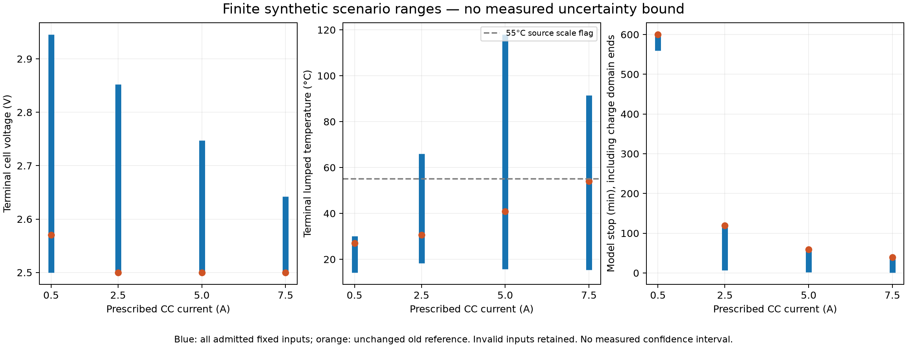

# 公開實驗室資料參數的合成情境基線（R5）

本輪已執行數值模型與完整固定情境；零新增擬合、零係數更新。標籤為 **公開實測資料校準之有效參數 + SYNTHETIC_ASSUMED 工況的模擬預測**。沒有恢復真實初始狀態／缺失歷史，也沒有建立新的實測誤差界限。

起點 `ee5ca8ada4542cb3ad985ba07971b9fe02b42cf5`；協議與情境先提交為 `28ce7e2`，之後才求解。本輪新增 opt-in 模組與獨立 CLI；原本 GUI、電池參數與驗收門檻未改。

## 已完成的計算

首個數值驗證批次開始於 2026-10-12T02:49:55.959093Z；完整新模型 17 tests 於 02:55:31.658593Z–02:55:33.289607Z 通過（pytest 1.14s／收據1.625s）。
獨立審查指出準備期峰值可能被遺漏後，修正報告收集而不改方程；新增history-temperature旗標回歸單項PASS（收據3.937s）。準備期峰值收集改動後，最終來源檔的完整18項檢查再核對一次：03:11:21.695705Z–03:11:24.556355Z，全18PASS（pytest1.94s／收據2.859s）。這次核對由實際程式改動觸發；沒有重跑主情境求解、改門檻或參數選擇。
固定情境主批次：2026-10-12T03:01:12.879951+00:00–2026-10-12T03:01:24.580555+00:00，driver 11.688s；91組×4電流=364案例，936,456列包含 gap/rest/main 軌跡。

執行收據保留單 CPU affinity、IDLE、six thread limits=1、$0及每批上限。FPV 作業使用互斥鎖；觀察到 Lean/Lake 時只暫停自己的計算，other priority work正常優先序工作優先。觀察到的空清單不證明整台電腦沒有其他工作。沒有安裝或更改網路、防火牆、安全設定。

## 固定設計的範圍

以下包括所有符合已凍結先驗的情境；無效輸入原样記錄。這是有限設計的 min/max，不是連續參數域的保證範圍、機率分布、實測信賴區間或優選參數。模型 domain end above2.5V 不是物理截止，更不是飛行續航。

| CC A | 可計算（先驗內）/全部 | 模型停止 min | 模型2.5V截止 min（件數） | 終點V | 終點°C | 全phase取樣峰值°C |
|---:|---:|---:|---:|---:|---:|---:|
| 0.5 | 56/91 | 559.760–599.720 | 559.760–598.354 (37) | 2.500–2.945 | 14.253–30.011 | 26.800–55.030 |
| 2.5 | 56/91 | 6.756–119.808 | 6.756–119.808 (51) | 2.500–2.853 | 18.235–65.941 | 26.800–65.941 |
| 5 | 56/91 | 2.143–59.532 | 2.143–59.371 (52) | 2.500–2.747 | 15.703–117.929 | 26.800–117.929 |
| 7.5 | 56/91 | 1.221–39.226 | 1.221–39.226 (55) | 2.500–2.642 | 15.451–91.388 | 34.088–91.388 |

溫度是 lumped proxy；峰值僅在5s網格及電壓分段／終點取樣。cases另留main/history/all-phase峰值；外推旗標涵蓋準備期，冷卻不清除已超尺度紀錄。超過55°C只是超出既有來源溫度尺度的旗標，沒有新增熱截止或已驗證溫度律。CSV的time_s為各phase起點算起；history端點保留同一charge anchor與狀態連續性。

5A合成情境最高終點117.929°C只暴露模型與先驗的外推幅度，不是可信操作範圍；沒有溫度相依參數、相變／老化或實測資料支持這一溫度。低電流情境中部分先驗能產生2.5V事件，也不修正原6/8及整體FAIL。

## 所有失敗／停止原因

| 狀態 | 件數 |
|---|---:|
| `DOMAIN_END_WITHOUT_PHYSICAL_CUTOFF` | 29 |
| `INVALID_CHARGE_DOMAIN` | 8 |
| `INVALID_HISTORY_UPPER_VOLTAGE_PRIOR` | 60 |
| `INVALID_INITIAL_RC_ENERGY_PRIOR` | 72 |
| `PHYSICAL_CUTOFF_2P5_V` | 195 |

無效初始能量、上限電壓或charge-domain情境沒有重抽、修補、裁切，也沒有等待極化鬆弛後才宣稱原初始狀態有效。若有上限電壓造成的partial trace，保留在cases/traces中並排除於可用範圍；物理截止欄位只為真正2.5V事件填值。

## 物理假設與來源

基礎Q/R0/R1/fast tau30/C/H/9U來自原 cell02 四條CC校準；13個potential節點只插值原9U，加事先列明delta*(1-z)壓力情境，沒有自由擬合。anchor=.95/.98/1、p_fast=±.08/0、p_slow=±.4/0、slow R=.05/.2/.8Ω、tau=300/1000/10000/100000s、gap I=±.05/0A、C/H與初始/環境溫度全部是情境先驗，不是識別出的物理量。初始RC能量上限0.1*3600Q*4.25J是工程先驗，只作用在anchor，不是能量守恆定律或實測界限。

0/2640/2760s gap +7200s rest是合成的pre-run模板；2640..2760來源於R4的條件式wall display算術，**不是原SBr的真實時間或歷史重建**。eta=1，charge signed current連續積分，不把每段強制reset至1。z域終点若浮點算術產生負一個ulp，只將終點time以nextafter向0移；未clamp z或改Q。

每個RC支路 C_RC=tau/R，E_RC=tau*p²/(2R)，heat=I²R0+Σp²/R≥0，I(U−V)=heat+dE_RC/dt。溫度使用指數卷積與重合pole極限。U與溫度無關、reversible heat=0是明示的簡化；加入slow RC可能與有效U所吸收的損失重複，不代表已修復真實擴散或熵熱。

原始來源：[Chen et al. LG M50 record4032561](https://doi.org/10.5281/zenodo.4032561)，原先核對CC BY4.0、型號LG M50、A/V/s/Ah/degC單位。這輪僅核對已存在原始檔hash，沒有新增下載、來源搜尋、拒絕來源繞路或新量測數據。raw SHA256 `650e7f9ac5217b4db158047e50b6b464100b13f4859002421114edebca629b35`；params `01d086e50d981c3a52349531b51aca82c8990c4c2e0b6462bc111267f84d7cef`。

## 數值誤差與原實測誤差

獨立DOP853（四個預先列明的完整history+2.5A案例）最大差：V=8.54e-13V，T=1.25e-12K，截止time=4.29e-07s；皆低於凍結門檻。負控包含先跌後回升的首個截止、current jump、overflow、initial energy、disabled RC及upper-V；被禁止的狀態保持拒絕。這些數值誤差不等於實測預測誤差。

既有實測留出結果保持：V RMSE51.941341→17.774347mV；surface-temperature proxy RMSE4.273934→1.258120K；**6/8 PASS、兩個低電流cutoff FAIL、aggregate scientific FAIL**。這是以前校準的紀錄，不是本輪新改善。原參數與封存old8曲線／metrics bytes未改，未重新執行old8數值回放；沒有本輪新old8 before/after量測驗證。cells03/04只為已知回歸，沒有新未見holdout。本輪新情境没有實測before/after誤差。ORegan30 fail、Chen12的6fail與Stanford既有紀錄均保留。

首批synthetic-r5-checks-01意外包含耗時的舊封存數值回放；17項新模型檢查已完成，後續舊回放部分被停止，收據exit4294967295/322.094s。停止只針對收據與start time核對的本任務子程序；原始stdout/stderr完整保留，不得稱為27PASS。新模型checks-02完整17PASS，新增峰值收集後final-checks完整18PASS；舊封存改以byte invariance核對。初次lint有3條line length剩餘失敗，也保留後再修復。

## 證據、獨立審查与交付

基線全部840個tracked檔案與原Git blob逐byte相同；此840檔proof涵蓋tracked資料、fail logs、GUI/science source與gates。先前三個task-root交付包本輪未寫入／重封存，未歸入此840檔proof。基線核對不是舊科學驗收的重跑或通過證明。

`public-lab-synthetic-evidence/`含immutable protocol/scenarios/oracle cases、primary-01所有364 cases及gzip全部軌跡、one-factor CSV（所有控制情境）、numerical-verification、840檔byte manifest、execution收據/原始logs、runner及独立审查。模型/driver/結果/軌跡hash在results與交付manifest可追溯。

复現：在repo環境以PYTHONPATH=src執行`python scripts/run_public_lab_synthetic.py --output <new-empty-dir>`，需要固定原始cell02檔與凍結參數；勿覆蓋primary-01。

獨立審查見 `public-lab-synthetic-evidence/independent-review.md`；HTTP有限診斷在獨立 `fpv-http-lifecycle` worktree／branch，單獨報告與commit。未合併、未部署、未推送遠端，也未覆蓋other workspace工作。

剩餘科學限制：新RC、charge anchor、真實missing input、OCV與溫度相依律未識別；沒有新未見實測驗證；motor/ESC/槳/推力及飛行續航仍條件式／未驗證。本輪完成的是合成基線與數值正確性，沒有把文獻或計畫算作新校準。

圖表QA發現footer與x軸文字重疊，僅從保存的primary數值重畫版面並核對圖片；修復前圖與實際report-driver source仍保留。Matplotlib字型cache改用task內路徑，原permission warning保留。沒有新增physics solve或改數值。HTTP診斷另行提交`83b90eebfe3be774cbcaf74f32d61a768e90536d`，原10tests PASS，歷史Win10053仍UNRESOLVED；詳見獨立worktree的public-lab-http-lifecycle-report.md。

## Repository publication note

This page publishes completed local findings, not a new calibration or run. The source commits cited above are local provenance, not claimed remote commits. This reports branch contains documentation and archival evidence only; the reproduction command requires the original candidate worktree and pinned raw input, not this branch. The 28.6MB complete trace is omitted; all364 case results, fixed inputs and its original digest are retained. Hashes of omitted bytes do not establish public waveform verification. Private paths and unrelated work names are redacted; original and public hashes appear in [publication-manifest.json](publication-manifest.json). See the [HTTP report](public-lab-http-lifecycle-report.md) and [index](README.md).
