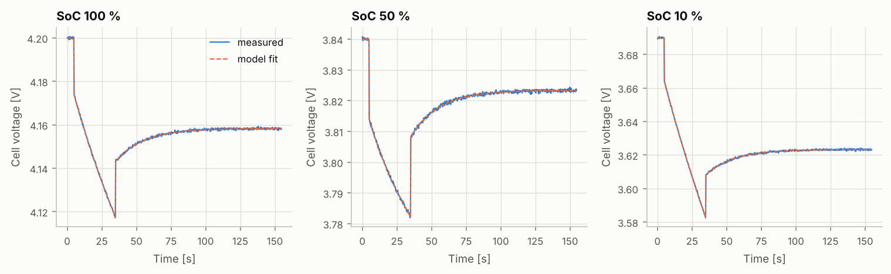
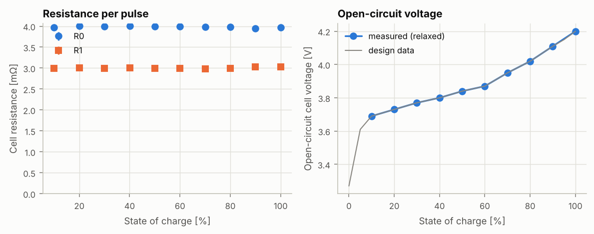
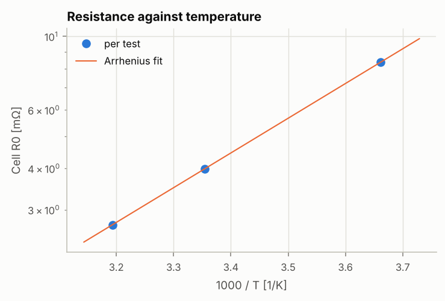
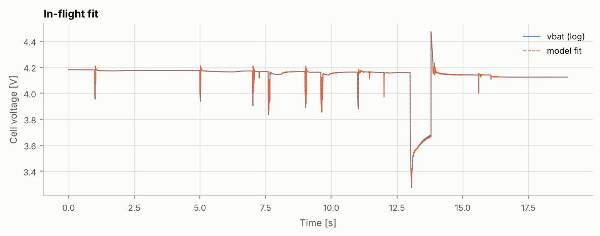

# 電池參數辨識報告

> 由 `fpvsim fit-battery` 自動產生。脈衝放電測試（HPPC）或飛行 log 的數據以 Thevenin 模型擬合，結果附標準不確定度；實測數據的結果可以直接取代零件檔中的估計值。

> **含模型產生的合成數據**（`hppc_0C.csv`、`hppc_25C.csv`、`hppc_40C.csv`、`flight_log.csv`（fpvsim 飛行模擬））：合成數據的結果只驗證辨識流程能否找回已知值，不是實測。

| 項目 | 內容 |
|---|---|
| 數據 | `reports/battery-fit/data/hppc_0C.csv`（合成）、`reports/battery-fit/data/hppc_25C.csv`（合成）、`reports/battery-fit/data/hppc_40C.csv`（合成）、`reports/flight-freestyle/flight_log.csv`（合成） |
| 串聯 × 並聯 | 6S1P |
| 程式版本 | fpvsim 0.1.0，git `f6b199d053aa`；Python 3.13.16、numpy 2.5.3、scipy 1.18.1、matplotlib 3.11.2 |
| 產生時間 (UTC) | 2026-10-15 12:45 |

## 1. 脈衝放電測試（HPPC）

每個電量點：靜置到電壓穩定（讀開路電壓）→ 放電脈衝 → 靜置看電壓恢復。每個脈衝與它後面的恢復段一起用Thevenin 模型以非線性最小平方擬合：脈衝邊緣的瞬間壓降決定 R0，脈衝中慢慢增加、靜置時慢慢恢復的部分決定 R1 與 τ1。開路電壓在一個脈衝的範圍內視為直線。

| 數據 | 溫度 | 脈衝數 | 單芯 R0 (mΩ) | 單芯 R1 (mΩ) | τ1 (s) | 最大殘差（單芯 RMS） |
|---|---|---|---|---|---|---|
| `reports/battery-fit/data/hppc_0C.csv` | 0.0 °C | 10 | 8.351 ± 0.023 | 6.282 ± 0.022 | 20.01 ± 0.12 | 0.4 mV |
| `reports/battery-fit/data/hppc_25C.csv` | 25.0 °C | 10 | 3.984 ± 0.021 | 3.002 ± 0.019 | 20.04 ± 0.21 | 0.4 mV |
| `reports/battery-fit/data/hppc_40C.csv` | 40.0 °C | 10 | 2.703 ± 0.020 | 2.040 ± 0.019 | 20.07 ± 0.29 | 0.3 mV |

不確定度包含兩部分：單一脈衝擬合的統計誤差，以及不同電量之間的差異。模型假設內阻不隨電量變化；如果各脈衝的值有系統性的趨勢（真實電池在低電量時內阻通常上升），這個差異就代表模型本身的誤差。

`hppc_25C.csv`（25 °C，最接近設計的參考溫度）的擬合（低、中、高電量各一個脈衝）：





| 電量 | 開路電壓（單芯） | 單芯 R0 (mΩ) | 單芯 R1 (mΩ) | τ1 (s) |
|---|---|---|---|---|
| 100% | 4.200 V | 3.968 ± 0.010 | 3.024 ± 0.012 | 20.02 ± 0.16 |
| 90% | 4.110 V | 3.951 ± 0.011 | 3.029 ± 0.013 | 19.86 ± 0.16 |
| 80% | 4.020 V | 3.983 ± 0.011 | 2.999 ± 0.012 | 20.12 ± 0.16 |
| 70% | 3.950 V | 3.979 ± 0.010 | 2.986 ± 0.012 | 19.90 ± 0.16 |
| 60% | 3.870 V | 3.999 ± 0.010 | 2.993 ± 0.012 | 19.97 ± 0.16 |
| 50% | 3.840 V | 3.994 ± 0.011 | 2.988 ± 0.012 | 19.89 ± 0.16 |
| 40% | 3.800 V | 4.000 ± 0.010 | 3.010 ± 0.012 | 20.13 ± 0.15 |
| 30% | 3.770 V | 3.998 ± 0.010 | 2.995 ± 0.012 | 20.14 ± 0.16 |
| 20% | 3.730 V | 4.001 ± 0.010 | 3.005 ± 0.012 | 20.26 ± 0.16 |
| 10% | 3.690 V | 3.965 ± 0.010 | 2.995 ± 0.012 | 20.11 ± 0.16 |

## 2. 內阻對溫度

不同溫度的測試以 ln R0 = ln R_ref + (Eₐ/R)(1/T − 1/T_ref) 迴歸，得到 Arrhenius 活化能。

| 參數 | 數值 |
|---|---|
| 活化能 Eₐ | 20.06 ± 0.11 kJ/mol |
| 單芯 R0（25 °C） | 3.983 ± 0.014 mΩ |



## 3. 飛行 log

整段飛行用同一個模型擬合，開路電壓取自設計的 OCV 曲線，電量由電流積分（假設起飛時滿電）。得到的電阻包含電池到 vbat 量測點之間的線路，而且是飛行中各種溫度與電量的平均，只能當作檢查，不能取代脈衝測試。

**這份 log 是 fpvsim 飛行模擬產生的**，所以下面的結果只檢查辨識流程，不是實測。

| 參數 | 數值 |
|---|---|
| 電池 + 線路電阻（整包） | 26.17 ± 0.00 mΩ |
| R1（整包） | 19.75 ± 0.23 mΩ |
| τ1 | 23.0 ± 0.3 s |
| 殘差（單芯 RMS） | 1.4 mV |

誤差是Jacobian 估計的統計誤差；飛行中溫度與電量都在變，實際不確定度更大。



## 4. 寫回零件檔

取最接近設計參考溫度的測試（`hppc_25C.csv`，25.0 °C）；`r_ref_temperature` 就是它的溫度。u 只含擬合的統計不確定度（A 類）；實測時還要依儀器規格加上 B 類不確定度（GUM），例如荷重元、電流計與溫度計的校正誤差。

**`hppc_25C.csv` 是模型產生的合成數據**（檔案第一行標記），所以來源標為 `synthetic`：它只能驗證辨識流程能否找回已知值，不能當作實測值寫回零件檔。

```toml
[params]
r0_cell = { value = 3.984, unit = "mohm", source = "synthetic", u = 0.021, ref = "hppc_25C.csv", note = "HPPC，25 °C" }
r1_cell = { value = 3.002, unit = "mohm", source = "synthetic", u = 0.019, ref = "hppc_25C.csv" }
tau1 = { value = 20.04, unit = "s", source = "synthetic", u = 0.21, ref = "hppc_25C.csv" }
r_ref_temperature = { value = 25.0, unit = "degC", source = "synthetic", ref = "hppc_25C.csv" }
resistance_activation_energy = { value = 20.06, unit = "kJ/mol", source = "synthetic", u = 0.11, ref = "hppc_0C.csv, hppc_25C.csv, hppc_40C.csv" }
```

開路電壓的量測點（電量 0% 需要另做完整放電測試）：

```toml
[ocv]
source = "synthetic"
soc = [0.100, 0.200, 0.300, 0.400, 0.500, 0.600, 0.700, 0.800, 0.900, 1.000]
cell_voltage = [3.6900, 3.7300, 3.7701, 3.8000, 3.8400, 3.8700, 3.9500, 4.0198, 4.1100, 4.2000]
```

與設計數據比較：

| 參數 | 設計數據（參考機：5 吋 6S freestyle（通用零件）） | 辨識結果 |
|---|---|---|
| 單芯 R0 | 4.000 mΩ | 3.984 ± 0.021 mΩ |
| 單芯 R1 | 3.000 mΩ | 3.002 ± 0.019 mΩ |
| τ1 | 20.00 s | 20.04 ± 0.21 s |
| 活化能 | 20.0 kJ/mol | 20.06 ± 0.11 kJ/mol |

兩者都是 25 °C 的值。

