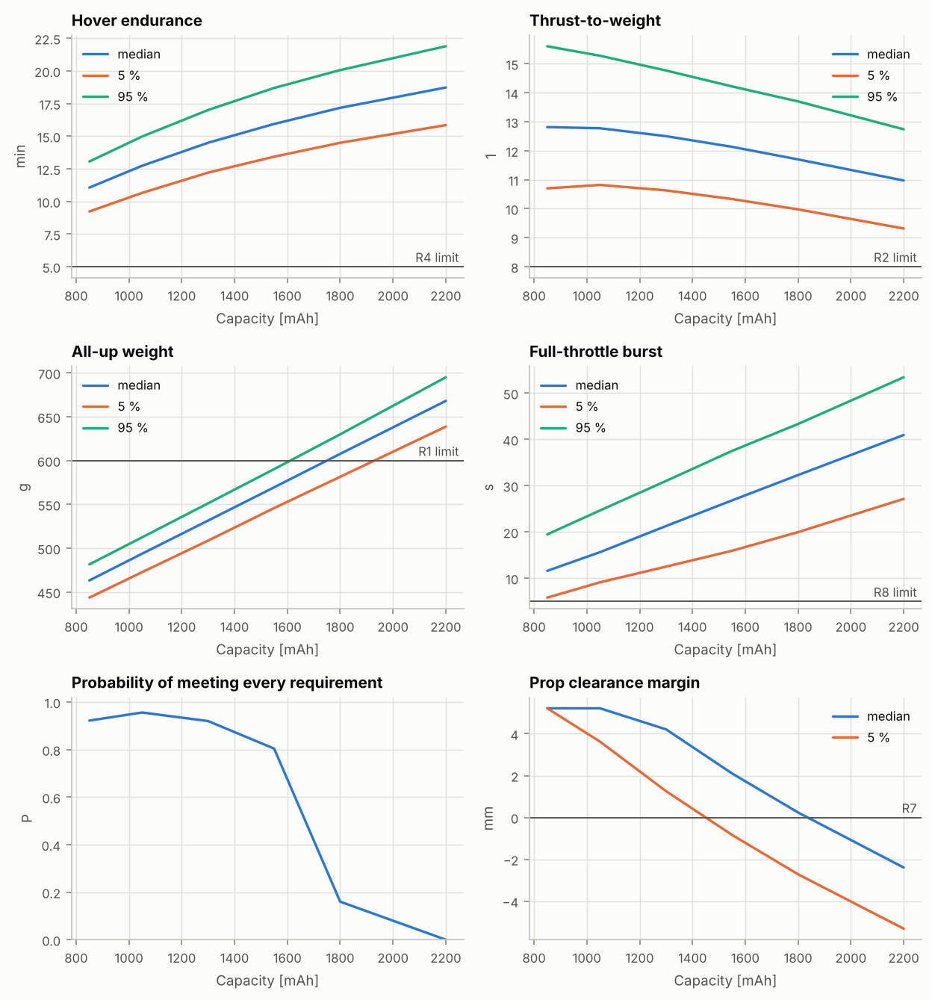

# 電池選型報告：參考機：5 吋 6S freestyle（通用零件）

> 由 `fpvsim battery-sweep` 自動產生。同一系列電池（同電芯、同工法）在不同容量下的縮放，縮放律與限制見 docs/battery.md。

| 項目 | 內容 |
|---|---|
| 機體 | 參考機：5 吋 6S freestyle（通用零件）（`data/builds/ref-5in-6s-freestyle.toml`） |
| 基準電池 | `data/components/batteries/generic-6s-1300mah.toml`，1300 mAh |
| 縮放參數 | 固定質量 18 ± 5 g；內阻指數 1 ± 0.15 |
| 蒙地卡羅 | 每個容量 500 組，種子 1；各容量使用相同的樣本（成對比較） |
| 程式版本 | fpvsim 0.1.0，git `f6b199d053aa`；Python 3.13.16、numpy 2.5.3、scipy 1.18.1、matplotlib 3.11.2 |
| 輸入檔雜湊 | `840c2bd32520d2ec` |
| 產生時間 (UTC) | 2026-10-15 12:47 |

## 摘要

- **建議容量：1050 mAh**，符合全部規格的機率 96%（在機率最高的容量中，取懸停續航中位數最長者）。
- 往小一級（850 mAh）：符合機率 92%，各規格都在 95% 以上。
- 往大一級（1300 mAh）：符合機率 92%，各規格都在 95% 以上。
- 驗證：基準容量的掃描點與設計報告的標稱值相同（懸停續航 14.42 min）。

## 1. 各容量的結果

標稱值，括號內為 90% 區間（蒙地卡羅 5% 到 95%）。

| 容量 mAh | 全備重量 g | 尺寸 mm | 推重比 | 懸停續航 | 全油門持續 | 全油門單芯電壓 | 槳葉間隙餘量 | 符合全部規格 |
|---|---|---|---|---|---|---|---|---|
| 850 | 464 | 65 × 30 × 33 | 12.84（10.70 – 15.60） | 11.02 min（9.23 – 13.05） | 11.9 s（5.8 – 19.5） | 3.34 V（3.03 – 3.71） | 5.2 mm（5.2 – 5.2） | 92% |
| 1050 | 494 | 70 × 33 × 35 | 12.81（10.82 – 15.28） | 12.68 min（10.65 – 14.97） | 16.1 s（9.1 – 24.6） | 3.45 V（3.18 – 3.78） | 5.2 mm（3.6 – 5.2） | 96% |
| 1300 | 532 | 75 × 35 × 38 | 12.54（10.63 – 14.77） | 14.42 min（12.21 – 17.01） | 21.7 s（12.5 – 31.0） | 3.55 V（3.30 – 3.83） | 5.2 mm（1.3 – 5.2） | 92% |
| 1550 | 570 | 80 × 37 × 40 | 12.16（10.33 – 14.22） | 15.87 min（13.43 – 18.70） | 27.8 s（15.9 – 37.5） | 3.63 V（3.40 – 3.88） | 5.1 mm（-0.8 – 4.2） | 80% |
| 1800 | 607 | 84 × 39 × 42 | 11.74（9.98 – 13.70） | 17.08 min（14.49 – 20.07） | 34.4 s（20.0 – 43.3） | 3.68 V（3.47 – 3.92） | 3.2 mm（-2.7 – 2.3） | 16% |
| 2200 | 668 | 89 × 42 × 45 | 11.04（9.31 – 12.74） | 18.64 min（15.85 – 21.89） | 44.0 s（27.1 – 53.4） | 3.75 V（3.56 – 3.95） | 0.5 mm（-5.3 – -0.3） | 0% |

## 2. 各規格的符合機率

| 規格 | 850 mAh | 1050 mAh | 1300 mAh | 1550 mAh | 1800 mAh | 2200 mAh |
|---|---|---|---|---|---|---|
| R1 全備重量 | 100% | 100% | 100% | 98% | 31% | 0% |
| R2 靜態推重比（滿電、全油門、含重心配平） | 100% | 100% | 100% | 100% | 100% | 100% |
| R3 懸停油門（馬達輸出，滿電） | 100% | 100% | 100% | 100% | 100% | 100% |
| R4 懸停續航 | 100% | 100% | 100% | 100% | 100% | 100% |
| R5 全油門槳尖馬赫數 | 98% | 98% | 95% | 94% | 89% | 83% |
| R6 重心與推力中心的水平偏移 | 98% | 98% | 98% | 97% | 97% | 96% |
| R7 槳葉間隙餘量（最差的零件） | 100% | 100% | 99% | 88% | 57% | 2% |
| R8 全油門可持續時間（滿電） | 95% | 100% | 100% | 100% | 100% | 100% |
| **全部** | **92%** | **96%** | **92%** | **80%** | **16%** | **0%** |

**邊際效益**（標稱值）：每多一克電池換到的懸停時間。

| 容量 | 質量增加 | 懸停續航增加 | 每克 |
|---|---|---|---|
| 850 → 1050 | +30 g | +99 s | 3.28 s/g |
| 1050 → 1300 | +38 g | +105 s | 2.76 s/g |
| 1300 → 1550 | +38 g | +87 s | 2.30 s/g |
| 1550 → 1800 | +38 g | +73 s | 1.92 s/g |
| 1800 → 2200 | +61 g | +93 s | 1.54 s/g |

## 3. 方法與假設

- 縮放律（容量比 r = C/C₀）：容量 × r；質量 = 固定質量 + (基準質量 − 固定質量) × r；內阻 × r^(−n)；尺寸每邊 × r^(1/3)；對流散熱 × r^(2/3)；熱容量隨質量；標示 C 數不變。
- 電池底面（靠機架的一面）固定，較大的電池往上長；`mounted_on` 電池的零件（綁帶、相機座）跟著頂面移動。
- 每個樣本的縮放後數值由該樣本的基準電池參數與縮放參數計算，所以各容量是成對比較；r = 1 時與設計報告完全相同。
- 只換電池，其他零件不變；飛控增益、動力系統都沒有重新最佳化。實際選型時，較重的電池可能需要重新調參。
- 真實電池系列的縮放未必如此規則（例如不同容量用不同電芯、外形只改長度）；有兩種以上容量的實測質量與內阻時，應以它們取代縮放律。
