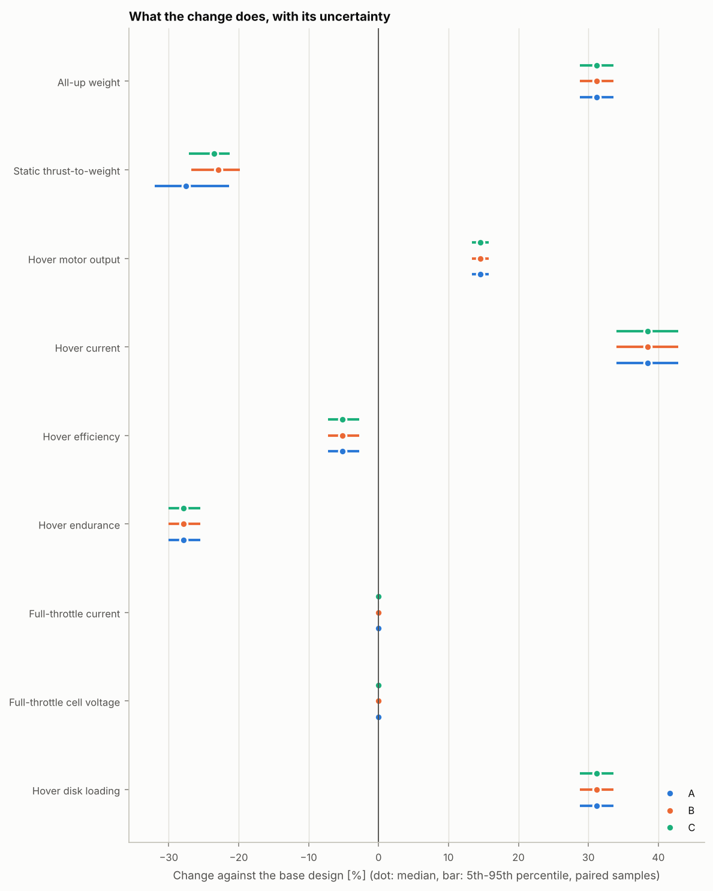
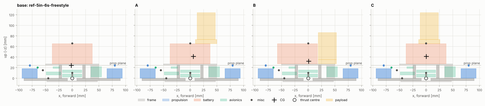
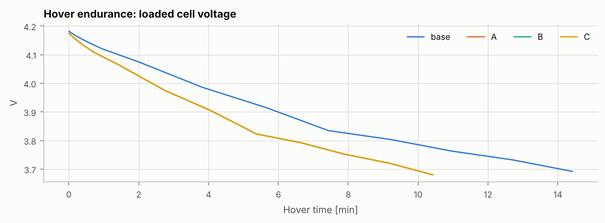
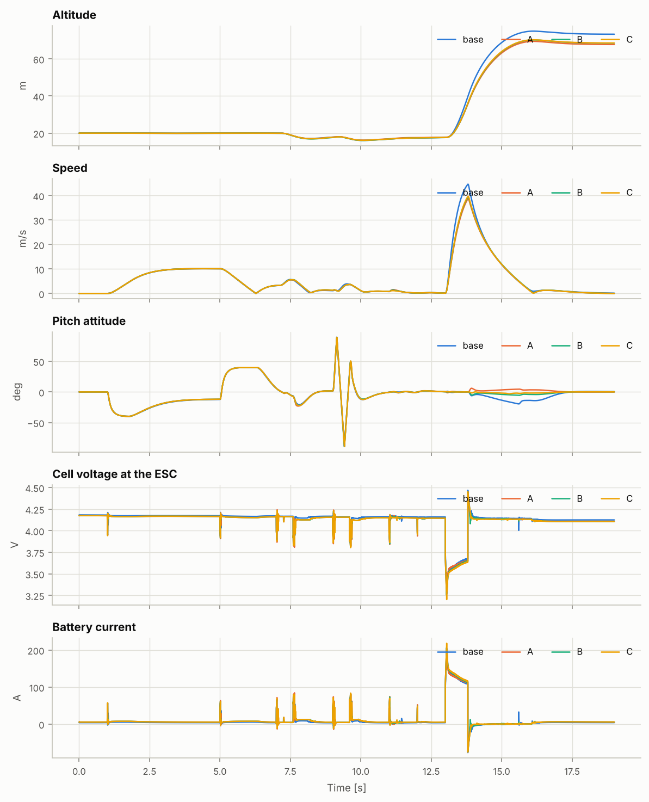
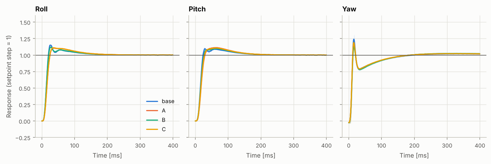

# 設計迭代比較報告

> 由 `fpvsim compare` 自動產生。所有版本用相同的設定分析：同一個隨機種子、相同的蒙地卡羅樣本數、同一份規格、相同的飛控設定與飛行腳本。蒙地卡羅是**成對**的：在第 i 組樣本中，各版本共有的零件（同一個零件檔與零件名稱、同樣數值的參數）取相同的值，所以差異是逐組直接算出來的，不受兩次獨立抽樣的雜訊干擾。但共有零件仍會影響變更的**大小**（例如槳的效率決定了多 165 g 要多耗多少電），所以差異的區間也包含它們的不確定度，見第 3 節的敏感度分析。

| 代號 | 版本 | 設計檔 | 相對基準的變更（演進順序） | 輸入檔雜湊 |
|---|---|---|---|---|
| base | 參考機：5 吋 6S freestyle（通用零件） | `data/builds/ref-5in-6s-freestyle.toml` | 基準設計 | `840c2bd32520` |
| A | 版本 A：運動相機綁在電池前端 | `data/builds/ref-5in-6s-freestyle-actioncam-a.toml` | 加掛全尺寸運動相機（綁在電池前端），電池位置不變 | `2dcf9045105e` |
| B | 版本 B：相機裝在上板前端、電池後移 | `data/builds/ref-5in-6s-freestyle-actioncam-b.toml` | 加掛全尺寸運動相機（上板前端），電池後移 20 mm | `f79ea915d78b` |
| C | 版本 C：相機綁在電池上方、移到重心正上方 | `data/builds/ref-5in-6s-freestyle-actioncam-c.toml` | 加掛全尺寸運動相機（綁在電池前端），電池位置不變 → 相機與相機座往後移 24 mm，位於重心正上方 | `281a79a5de66` |

| 項目 | 內容 |
|---|---|
| 規格 | 5 吋 6S freestyle 設計規格（範例）（`freestyle-5in-6s`），所有版本相同 |
| 飛控設定 | 5 吋 Acro 基準設定（`acro-5in-baseline`，設定雜湊 `b021b7873281ce99`），所有版本相同 |
| 蒙地卡羅 | 每個版本 1000 組成對樣本，隨機種子 1 |
| 飛行腳本 | `freestyle`：綜合飛行：10 m/s 前飛、滾轉翻、後空翻、原地自轉、衝刺、收油下墜 |
| 程式版本 | fpvsim 0.1.0，git `f6b199d053aa`；Python 3.13.16、numpy 2.5.3、scipy 1.18.1、matplotlib 3.11.2 |
| 產生時間 (UTC) | 2026-10-15 13:50 |

## 摘要

數值是標稱值的變化；括號裡的區間取自成對蒙地卡羅樣本。成對樣本的中位數與標稱值相差超過 1 個百分點時另外列出（非線性的指標，例如含重心配平的推重比，標稱值不等於中位數）。

- **A（版本 A：運動相機綁在電池前端）**：全備重量 +165 g（+31.0%），懸停續航 -27.8%（90% 區間 -30.1% 至 -25.4%），推重比 -27.1%（90% 區間 -32.0% 至 -21.4%），重心偏移 5.7 mm。新增不符合的規格：R1、R6。有風險：R2。
- **B（版本 B：相機裝在上板前端、電池後移）**：全備重量 +165 g（+31.0%），懸停續航 -27.8%（90% 區間 -30.1% 至 -25.4%），推重比 -22.8%（90% 區間 -26.7% 至 -19.8%），重心偏移 1.0 mm。新增不符合的規格：R1、R7。
- **C（版本 C：相機綁在電池上方、移到重心正上方）**：全備重量 +165 g（+31.0%），懸停續航 -27.8%（90% 區間 -30.1% 至 -25.4%），推重比 -21.9%（90% 區間 -27.2% 至 -21.3%，中位數 -23.5%），重心偏移 0.1 mm。新增不符合的規格：R1。
- 在變更後的版本中，**C 符合的規格最多**（7 / 8 項）。
- 所有變更後的版本都不符合 R1（全備重量）。若這條規格是為變更前的用途訂的，應先決定是放寬它，還是為新用途另訂規格；這是產品決策，不是工程問題。
- **控制：** 用相同的基準增益，滾轉超調在基準為 15.8%，A 11.3%、B 12.5%、C 11.4%。把 F 設為 0 再飛一次，滾轉超調是 base 15.4%、A 18.0%、B 15.7%、C 18.1%；feedforward 對超調的影響（有 F 減 F = 0）是 base +0.4、A -6.8、B -3.2、C -6.7 個百分點。各版本自己的調參建議見第 7 節。
- **槳葉間隙（R7）：** B 在標稱位置就不符合：`camera_mount`（第 2、4 顆槳：離槳盤邊緣 0.4 mm、離槳平面 3.0 mm，餘量 -2.6 mm）、`battery`（第 1、3 顆槳：離槳盤邊緣 1.1 mm、離槳平面 3.0 mm，餘量 -1.9 mm）（見第 4 節）。

## 1. 設計變更

**A** 相對基準設計：

| 類型 | 項目 | 變更前 | 變更後 |
|---|---|---|---|
| 新增零件 | `action_camera` | — | 153 g @ (30.0, 0.0, -98.5) mm |
| 新增零件 | `camera_mount` | — | 12 g @ (30.0, 0.0, -69.0) mm |

**B** 相對基準設計：

| 類型 | 項目 | 變更前 | 變更後 |
|---|---|---|---|
| 新增零件 | `action_camera` | — | 153 g @ (36.0, 0.0, -60.5) mm |
| 新增零件 | `camera_mount` | — | 12 g @ (36.0, 0.0, -31.0) mm |
| 移動 | `battery` | (0.0, 0.0, -46.0) mm | (-20.0, 0.0, -46.0) mm |

**C** 相對基準設計：

| 類型 | 項目 | 變更前 | 變更後 |
|---|---|---|---|
| 新增零件 | `action_camera` | — | 153 g @ (6.0, 0.0, -98.5) mm |
| 新增零件 | `camera_mount` | — | 12 g @ (6.0, 0.0, -69.0) mm |

## 2. 規格符合度

每格為符合機率（判定）。判定：≥ 95% 符合，50–95% 有風險，< 50% 不符合；與門檻相差不到兩倍蒙地卡羅標準誤差時標為「臨界」，換一個隨機種子可能落在另一邊。零件的安裝位置有標示不確定度時（例如電池與相機的 `position_u`），重心相關的機率已包含它。

| 編號 | 需求 | base | A | B | C |
|---|---|---|---|---|---|
| R1 | 全備重量 | > 99.7%（符合） | < 0.3%（不符合） | < 0.3%（不符合） | < 0.3%（不符合） |
| R2 | 靜態推重比（滿電、全油門、含重心配平） | > 99.7%（符合） | 88.4% ± 1.0%（有風險） | 96.3% ± 0.6%（符合） | 95.2% ± 0.7%（符合（臨界）） |
| R3 | 懸停油門（馬達輸出，滿電） | > 99.7%（符合） | > 99.7%（符合） | > 99.7%（符合） | > 99.7%（符合） |
| R4 | 懸停續航 | > 99.7%（符合） | > 99.7%（符合） | > 99.7%（符合） | > 99.7%（符合） |
| R5 | 全油門槳尖馬赫數 | 95.6% ± 0.6%（符合（臨界）） | 95.6% ± 0.6%（符合（臨界）） | 95.6% ± 0.6%（符合（臨界）） | 95.6% ± 0.6%（符合（臨界）） |
| R6 | 重心與推力中心的水平偏移 | 97.2% ± 0.5%（符合） | 35.4% ± 1.5%（不符合） | 99.7% ± 0.2%（符合） | 96.2% ± 0.6%（符合（臨界）） |
| R7 | 槳葉間隙餘量（最差的零件） | 98.2% ± 0.4%（符合） | 98.2% ± 0.4%（符合） | < 0.3%（不符合） | 98.2% ± 0.4%（符合） |
| R8 | 全油門可持續時間（滿電） | > 99.7%（符合） | > 99.7%（符合） | > 99.7%（符合） | > 99.7%（符合） |

## 3. 性能對照

標稱值為各版本所有參數取標稱值的結果。差異欄是**成對**樣本的差（版本減基準）：中位數與 90% 區間；百分比指標的差以百分點表示。下圖是同樣的差異換算成相對變化。

| 指標 | base 標稱值 | A 標稱值 | B 標稱值 | C 標稱值 | A − base（P5 – P95） | B − base（P5 – P95） | C − base（P5 – P95） |
|---|---|---|---|---|---|---|---|
| 全備重量 | 532 g | 697 g | 697 g | 697 g | +166 g（+155 – +176） | +166 g（+155 – +176） | +166 g（+155 – +176） |
| 重心與推力中心的水平偏移（大小；方向見第 4 節） | 1.8 mm | 5.7 mm | 1.0 mm | 0.1 mm | +3.9 mm（-2.3 – +8.7） | -0.7 mm（-3.5 – +2.3） | -0.3 mm（-1.9 – +3.0） |
| 靜態推重比（滿電、全油門、含重心配平） | 12.54 | 9.14 | 9.68 | 9.79 | -3.38（-4.41 – -2.44） | -2.83（-3.70 – -2.23） | -2.93（-3.73 – -2.38） |
| 懸停油門（馬達輸出，滿電） | 22.8% | 26.1% | 26.1% | 26.1% | +3.3 個百分點（+3.0 – +3.7） | +3.3 個百分點（+3.0 – +3.7） | +3.3 個百分點（+3.0 – +3.7） |
| 懸停總電流（滿電） | 4.02 A | 5.55 A | 5.55 A | 5.55 A | +1.54 A（+1.34 – +1.80） | +1.54 A（+1.34 – +1.80） | +1.54 A（+1.34 – +1.80） |
| 懸停效率 | 5.28 gf/W | 5.01 gf/W | 5.01 gf/W | 5.01 gf/W | -0.26 gf/W（-0.41 – -0.13） | -0.26 gf/W（-0.41 – -0.13） | -0.26 gf/W（-0.41 – -0.13） |
| 懸停續航 | 14.42 min | 10.42 min | 10.42 min | 10.42 min | -3.98 min（-4.94 – -3.24） | -3.98 min（-4.94 – -3.24） | -3.98 min（-4.94 – -3.24） |
| 全油門總電流（滿電） | 146.9 A | 146.9 A | 146.9 A | 146.9 A | +0.0 A（+0.0 – +0.0） | +0.0 A（+0.0 – +0.0） | +0.0 A（+0.0 – +0.0） |
| 全油門單芯電壓（滿電） | 3.55 V | 3.55 V | 3.55 V | 3.55 V | +0.00 V（+0.00 – +0.00） | +0.00 V（+0.00 – +0.00） | +0.00 V（+0.00 – +0.00） |
| 懸停槳盤負載 | 98.9 Pa | 129.6 Pa | 129.6 Pa | 129.6 Pa | +30.8 Pa（+28.8 – +32.8） | +30.8 Pa（+28.8 – +32.8） | +30.8 Pa（+28.8 – +32.8） |

### 差異的敏感度

每次只把一個參數移動 ±1σ，看差異（版本減基準）改變多少。共有參數在兩個版本同時移動，和成對抽樣一致。列出對續航差與推重比差影響最大的參數（依較大的一側排序）；兩側不對稱時，表示這個參數的影響是非線性的，例如安裝位置的誤差不論往哪邊偏，都讓重心離中心更遠：

**A**：

| 差異 | 參數 | 屬於 | 差異的改變（−1σ / +1σ） |
|---|---|---|---|
| 懸停續航 | `motor.i0_ref` | 共有 | -0.26 / +0.24 min |
| 懸停續航 | `motor.i0_speed_fraction` | 共有 | +0.22 / -0.24 min |
| 懸停續航 | `prop.fm_scale` | 共有 | +0.18 / -0.17 min |
| 懸停續航 | `prop.re_fm_exponent` | 共有 | -0.16 / +0.16 min |
| 靜態推重比（滿電、全油門、含重心配平） | `battery.offset_x` | 共有 | +0.49 / -0.49 |
| 靜態推重比（滿電、全油門、含重心配平） | `battery.r0_cell` | 共有 | -0.25 / +0.21 |
| 靜態推重比（滿電、全油門、含重心配平） | `prop.ct_scale` | 共有 | +0.16 / -0.13 |
| 靜態推重比（滿電、全油門、含重心配平） | `motor.rm` | 共有 | -0.13 / +0.12 |

**B**：

| 差異 | 參數 | 屬於 | 差異的改變（−1σ / +1σ） |
|---|---|---|---|
| 懸停續航 | `motor.i0_ref` | 共有 | -0.26 / +0.24 min |
| 懸停續航 | `motor.i0_speed_fraction` | 共有 | +0.22 / -0.24 min |
| 懸停續航 | `prop.fm_scale` | 共有 | +0.18 / -0.17 min |
| 懸停續航 | `prop.re_fm_exponent` | 共有 | -0.16 / +0.16 min |
| 靜態推重比（滿電、全油門、含重心配平） | `battery.offset_x` | 共有 | +0.33 / -0.41 |
| 靜態推重比（滿電、全油門、含重心配平） | `battery.r0_cell` | 共有 | -0.21 / +0.18 |
| 靜態推重比（滿電、全油門、含重心配平） | `prop.ct_scale` | 共有 | +0.13 / -0.11 |
| 靜態推重比（滿電、全油門、含重心配平） | `action_camera.mass` | 僅新版本 | +0.12 / -0.12 |

**C**：

| 差異 | 參數 | 屬於 | 差異的改變（−1σ / +1σ） |
|---|---|---|---|
| 懸停續航 | `motor.i0_ref` | 共有 | -0.26 / +0.24 min |
| 懸停續航 | `motor.i0_speed_fraction` | 共有 | +0.22 / -0.24 min |
| 懸停續航 | `prop.fm_scale` | 共有 | +0.18 / -0.17 min |
| 懸停續航 | `prop.re_fm_exponent` | 共有 | -0.16 / +0.16 min |
| 靜態推重比（滿電、全油門、含重心配平） | `battery.offset_x` | 共有 | -0.01 / -0.53 |
| 靜態推重比（滿電、全油門、含重心配平） | `battery.r0_cell` | 共有 | -0.20 / +0.17 |
| 靜態推重比（滿電、全油門、含重心配平） | `prop.ct_scale` | 共有 | +0.13 / -0.10 |
| 靜態推重比（滿電、全油門、含重心配平） | `motor.rm` | 共有 | -0.11 / +0.10 |

## 4. 質量、重心與慣性

| 版本 | 全備重量 | 重心偏移（前 + / 右 +） | 重心高於槳平面 | Ixx / Iyy / Izz (g·m²) | Ixz (g·m²) | 阻力面積 x / y / z (cm²) |
|---|---|---|---|---|---|---|
| base | 532 g | -1.8 / +0.1 mm | +0.1 mm | 1.372 / 1.564 / 2.450 | +0.009 | 60 / 80 / 180 |
| A | 697 g | +5.7 / +0.1 mm | +17.2 mm | 2.141 / 2.409 / 2.662 | +0.298 | 93 / 96 / 205 |
| B | 697 g | +1.0 / +0.1 mm | +8.2 mm | 1.629 / 2.072 / 2.833 | +0.113 | 93 / 96 / 205 |
| C | 697 g | +0.0 / +0.1 mm | +17.2 mm | 2.141 / 2.289 / 2.542 | +0.080 | 93 / 96 / 205 |

- 前飛時的阻力力矩：重心高於槳平面時，槳盤阻力作用在重心下方、指向後方，產生**低頭**力矩；機架本身的阻力作用在機架上的固定點（機架檔的 `drag_center`），重心升高後它也在重心下方，同樣產生低頭力矩；零件自己的阻力（例如相機）作用在零件位置，裝得比重心高時產生**抬頭**力矩。三者都由飛控修正，且都已包含在飛行模擬中。槳本身另有槳轂力矩（斜向氣流模型）：前進側升力較大造成的滾轉力矩在左右旋成對時互相抵消，俯仰力矩對參考槳很小（docs/models.md）。
- Ixz 是滾轉與偏航之間的慣性積（張量形式），不為零時兩軸的運動會互相耦合；裝在高處且偏前的零件會讓它變大。

**槳葉間隙：** 每個零件（機架與動力系統以外）要在槳盤外 3.0 mm 以上，或離槳平面 10.0 mm 以上。餘量是最差的零件在較容易的方向上還能移動多少，負值表示兩條都不滿足。間隙不足的機率取自蒙地卡羅樣本，包含零件安裝位置的不確定度（`position_u`）。

| 版本 | 餘量（標稱值） | 標稱值最接近的零件 | 離槳盤邊緣 / 離槳平面 | 間隙不足的機率 | 不足時的零件（樣本數） |
|---|---|---|---|---|---|
| base | +5.2 mm | `vtx`（第 1 顆槳） | +8.2 mm / 12.0 mm | 1.8% ± 0.4% | `battery` 18 |
| A | +5.2 mm | `vtx`（第 1 顆槳） | +8.2 mm / 12.0 mm | 1.8% ± 0.4% | `battery` 18 |
| B | -2.6 mm | `camera_mount`（第 2 顆槳） | +0.4 mm / 3.0 mm | > 99.7% | `battery` 659、`camera_mount` 341 |
| C | +5.2 mm | `vtx`（第 1 顆槳） | +8.2 mm / 12.0 mm | 1.8% ± 0.4% | `battery` 18 |

離槳盤邊緣為負值表示零件在俯視圖上位於槳盤範圍內。
B 在標稱位置就不符合規則的零件：`camera_mount`（第 2、4 顆槳：離槳盤邊緣 0.4 mm、離槳平面 3.0 mm，餘量 -2.6 mm）；`battery`（第 1、3 顆槳：離槳盤邊緣 1.1 mm、離槳平面 3.0 mm，餘量 -1.9 mm）。

## 5. 懸停續航

| 版本 | 懸停續航 | 結束原因 | 懸停電流 | 懸停油門 |
|---|---|---|---|---|
| base | 14.42 min | 達到保留電量 | 4.02 A | 22.8% |
| A | 10.42 min | 達到保留電量 | 5.55 A | 26.1% |
| B | 10.42 min | 達到保留電量 | 5.55 A | 26.1% |
| C | 10.42 min | 達到保留電量 | 5.55 A | 26.1% |

懸停續航取決於重量、動力系統與航電耗電，與重心位置無關；A、B、C 的重量與耗電相同，所以懸停續航相同。

## 6. 飛行測試對照

相同的飛控設定（基準增益）、相同的飛行腳本與隨機種子。**這是每個版本一次、所有參數取標稱值的飛行，沒有不確定度。**阻力面積、槳盤阻力係數、ESC 電流限制與振動等參數只用於模擬飛行（本節與第 7 節的調參）；它們的不確定度還沒有傳遞到飛行結果。

| 項目 | base | A | B | C |
|---|---|---|---|---|
| 前飛段末速度 | 10.1 m/s | 10.1 m/s | 10.1 m/s | 10.1 m/s |
| 前飛段末傾角 | 12.6 ° | 12.2 ° | 12.2 ° | 12.2 ° |
| 滾轉翻掉高度 | 2.85 m | 2.98 m | 3.13 m | 3.01 m |
| 後空翻掉高度 | 1.77 m | 1.60 m | 1.64 m | 1.65 m |
| 原地自轉平均角速度 | 607 deg/s | 607 deg/s | 608 deg/s | 607 deg/s |
| 衝刺 2 秒內爬升高度 | 51.2 m | 45.4 m | 46.2 m | 46.3 m |
| 最大爬升速度 | 44.7 m/s | 38.8 m/s | 39.5 m/s | 39.8 m/s |
| 最低單芯電壓 | 3.27 V | 3.33 V | 3.26 V | 3.20 V |
| 最大電流 | 203 A | 188 A | 206 A | 218 A |
| 用電量 | 51 mAh | 59 mAh | 60 mAh | 61 mAh |
| 滾轉追蹤誤差 (RMS) | 34.8 deg/s | 39.4 deg/s | 36.3 deg/s | 39.7 deg/s |
| 俯仰追蹤誤差 (RMS) | 37.4 deg/s | 42.9 deg/s | 40.7 deg/s | 41.5 deg/s |
| 混控飽和時間 | 0.6% | 0.8% | 0.7% | 0.7% |

前飛段末傾角：A、B、C 比基準重，傾角卻較小。定速前飛時 tan(傾角) ≈ 阻力 ÷ 重量；在 10.1 m/s 時槳盤阻力大約隨轉速（推力的平方根）增加，比重量增加得慢，所以阻力 ÷ 重量反而變小：base 0.243（槳盤阻力占 70%）、A 0.231（槳盤阻力占 63%）、B 0.231（槳盤阻力占 63%）、C 0.231（槳盤阻力占 63%）（一階估計，旋翼在懸停轉速）。

## 7. 控制響應與調參

圖中是所有版本都用**基準增益**時的步階響應，取自各版本調參研究中的基準候選。調參飛行的每一軸都有固定時間的小幅度步階，步階的時刻已知，所以直接在每一次步階量測，不必反卷積；表中是各次步階的中位數，括號為四分位距；+a → −a 的反向步階（兩倍幅度）與混控飽和的步階不計入。陰影是各次步階之間的標準差。

| 版本 | 滾轉超調 | 俯仰超調 | 偏航超調 | 上升時間（滾 / 俯） | 未安定的軸 | 調參建議 | 建議 P-D（滾轉 / 俯仰） |
|---|---|---|---|---|---|---|---|
| base | 15.8%（1.4%） | 10.1%（2.2%） | 27.3%（3.6%） | 10 / 11 ms | — | PD×1.45 D×1 | 58-44 / 61-48 |
| A | 11.3%（1.6%） | 11.5%（1.0%） | 18.6%（2.6%） | 13 / 15 ms | — | PD×1.75 D×0.8 | 70-42 / 74-46 |
| B | 12.5%（3.1%） | 10.1%（1.1%） | 14.1%（2.2%） | 11 / 13 ms | — | PD×1.45 D×1 | 58-44 / 61-48 |
| C | 11.4%（1.4%） | 10.8%（1.0%） | 21.4%（2.1%） | 13 / 14 ms | — | PD×1.75 D×0.8 | 70-42 / 74-46 |

超調主要來自 feedforward 的軸（基準增益下 F 設為 0 再飛一次的對照）：base：偏航 27.3% → 2.6%；A：偏航 18.6% → 3.0%；C：偏航 21.4% → 2.9%。PD 掃描改變不了這部分，應單獨調整該軸的 F。

各版本的掃描在建議值落在範圍邊緣時會自動擴大。建議值往各方向再走一格會碰到的限制：

- base：自動擴大 2 輪（PD 1.45、PD 1.6）。PD 再加（PD×1.6 D×1）馬達雜訊是基準的 1.57 倍（上限 1.5 倍）；PD 再減（PD×1.3 D×1）追蹤誤差沒有更好；D 再加（PD×1.45 D×1.25）馬達雜訊是基準的 4.57 倍（上限 1.5 倍）；D 再減（PD×1.45 D×0.8）超調 22.2% 超過 15%。
- A：自動擴大 3 輪（PD 1.45、PD 1.6、D 0.6、PD 1.75）。**仍在掃描範圍邊緣（PD 上限）**，下一輪應往 PD 增加的方向擴大。PD 再減（PD×1.6 D×0.8）追蹤誤差沒有更好；D 再加（PD×1.75 D×1）馬達雜訊是基準的 1.65 倍（上限 1.5 倍）；D 再減（PD×1.75 D×0.6）超調 25.3% 超過 15%。
- B：自動擴大 2 輪（PD 1.45、PD 1.6）。PD 再加（PD×1.6 D×1）馬達雜訊是基準的 1.52 倍（上限 1.5 倍）；PD 再減（PD×1.3 D×1）追蹤誤差沒有更好；D 再加（PD×1.45 D×1.25）馬達雜訊是基準的 1.65 倍（上限 1.5 倍）；D 再減（PD×1.45 D×0.8）超調 17.4% 超過 15%。
- C：自動擴大 3 輪（PD 1.45、PD 1.6、D 0.6、PD 1.75）。**仍在掃描範圍邊緣（PD 上限）**，下一輪應往 PD 增加的方向擴大。PD 再減（PD×1.6 D×0.8）追蹤誤差沒有更好；D 再加（PD×1.75 D×1）馬達雜訊是基準的 1.66 倍（上限 1.5 倍）；D 再減（PD×1.75 D×0.6）超調 25.4% 超過 15%。

## 8. 下一步

1. 決定 R1 是否適用於變更後的用途，必要時另訂規格，再用新規格重跑本比較。
2. 最影響版本差異的估計值（第 3 節敏感度）：`motor.i0_ref` — 無槳空載測試，至少兩個電壓；`motor.i0_speed_fraction` — 無槳空載測試，至少兩個電壓；`prop.fm_scale` — 推力台量測扭矩（或電流與轉速），以 `fpvsim fit-prop` 辨識 Cp，由 Ct 與 Cp 得到 FM；`battery.offset_x` — 量測實際安裝位置（每次安裝）；`battery.r0_cell` — 脈衝放電測試（HPPC）量測瞬間與極化壓降；`prop.ct_scale` — 推力台量測靜態推力，以 `fpvsim fit-prop` 辨識 Ct。
3. 第 6 節的飛行結果另外取決於阻力面積與槳盤阻力（`prop.flap_fraction`），它們要由風洞（`fpvsim fit-tunnel`）或飛行測試（定速平飛的傾角對速度、滑行減速）辨識；目前飛行結果沒有不確定度。
4. 採用的版本依第 7 節的建議重新調參後，再飛一次比較。

## 9. 方法與限制

- 成對蒙地卡羅：每個參數的亂數流由（種子，物品身分）決定：零件檔的參數以零件檔（id 與檔案內容）加上零件名稱為身分，其他參數以名稱、數值、不確定度、分布與來源為身分。所以同一個零件在各版本的第 i 組樣本中取值相同；換了零件檔、改了檔案內容或數值、或用了新的零件名稱，就視為不同的物品，誤差彼此獨立。
- 差異的區間包含共有參數的影響：它們不會被成對抽樣消去，因為變更的效果大小本身就取決於它們（見第 3 節敏感度）。
- 阻力以零件疊加估計：機架的阻力作用在機架上的固定點（`drag_center`，估計值），零件的阻力作用在零件位置；零件之間的干擾、相機傾角對阻力的影響，以及電池移動造成的機架阻力中心變化都未計。
- 相機視為剛性安裝；TPU 軟座的振動隔離與畫面果凍效應不在模型內。相機在前槳上方時對進氣的遮擋也未計。
- 陀螺儀振動模型的振幅以角速度表示、只隨轉速變化，所以各版本沿用同一組數值。實際上同樣的不平衡力作用在較大的慣性上，角速度振動會較小：A、B、C 的三軸慣量都比基準大，雜訊估計偏保守。
- 推重比只計入維持水平所能用的推力：重心偏離推力中心時，靠近重心那側的馬達先到滿載。
- 零件可以標示 `mounted_on`（例如相機座綁在電池上）：它的安裝位置誤差等於母零件的誤差加上自己相對母零件的誤差。
- 所有版本使用同一份規格；若版本的規格不同，`fpvsim compare` 會拒絕比較。
