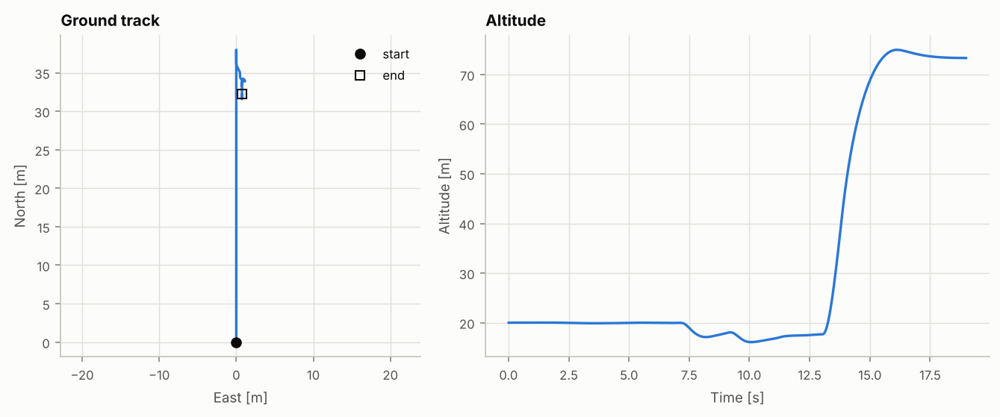
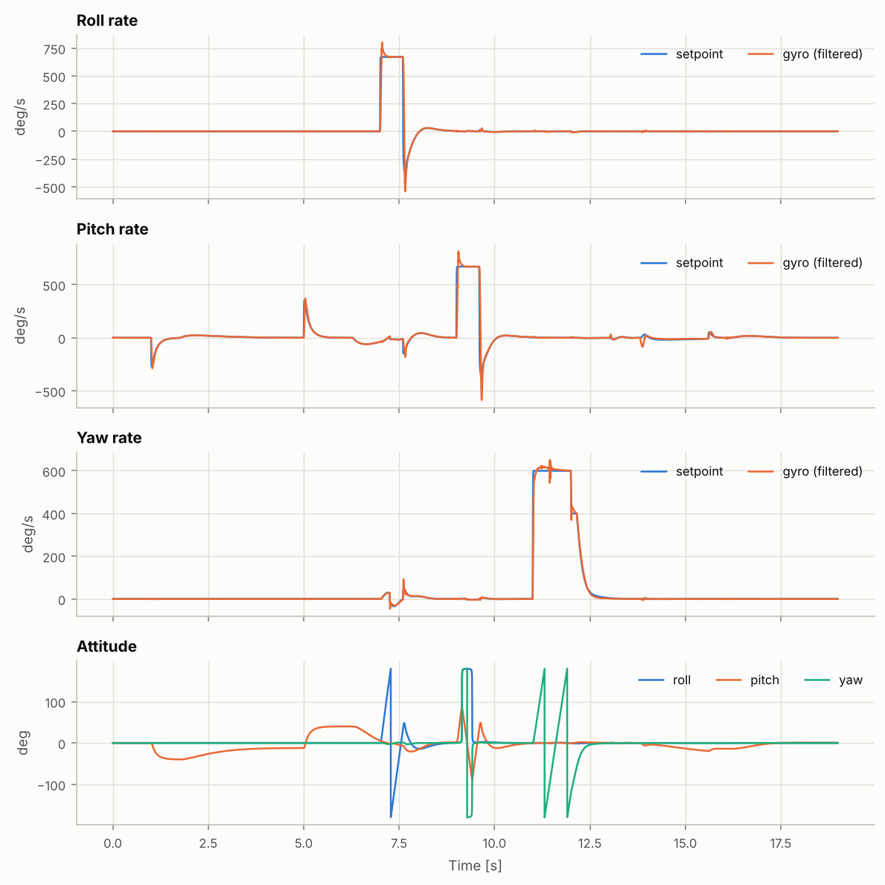
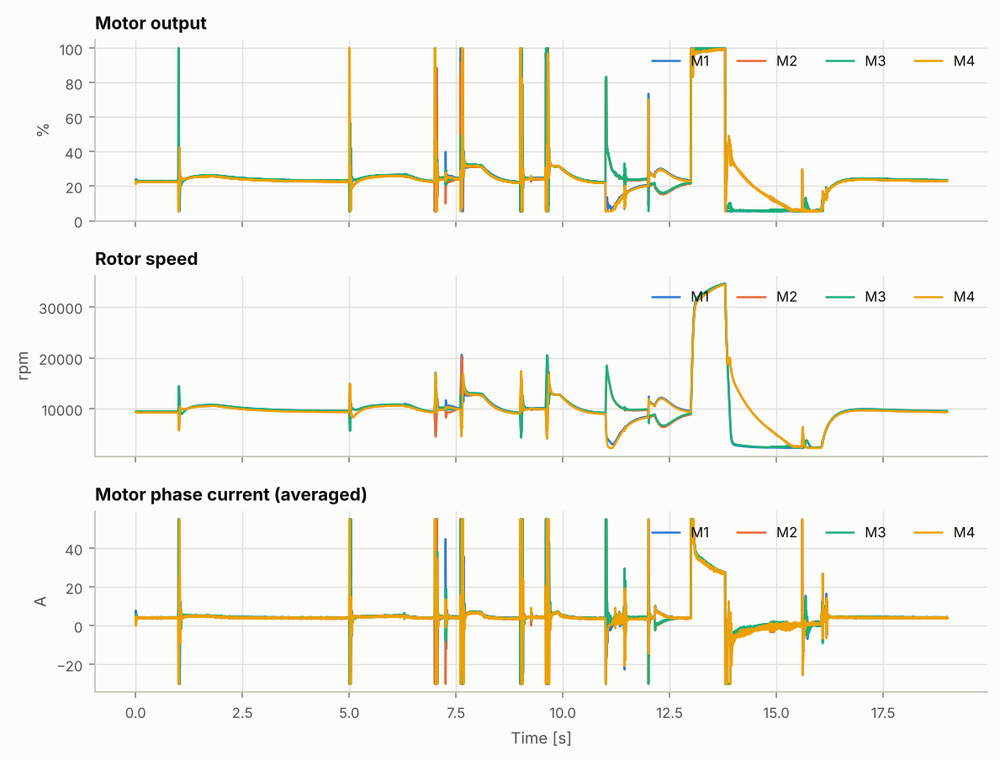
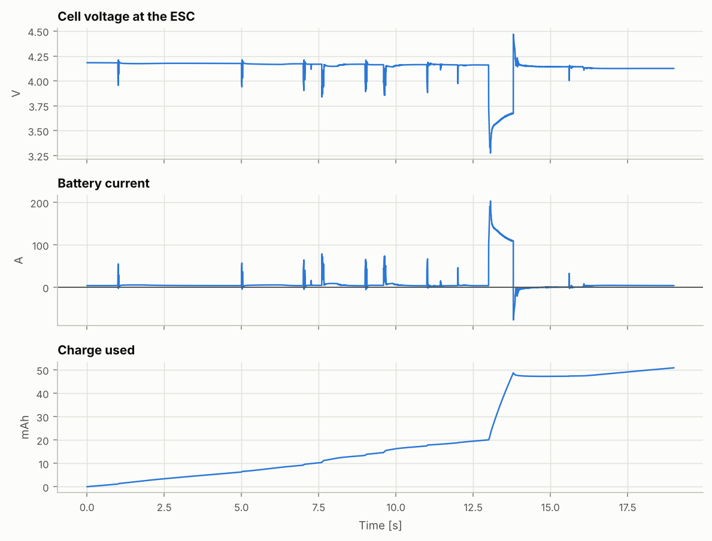
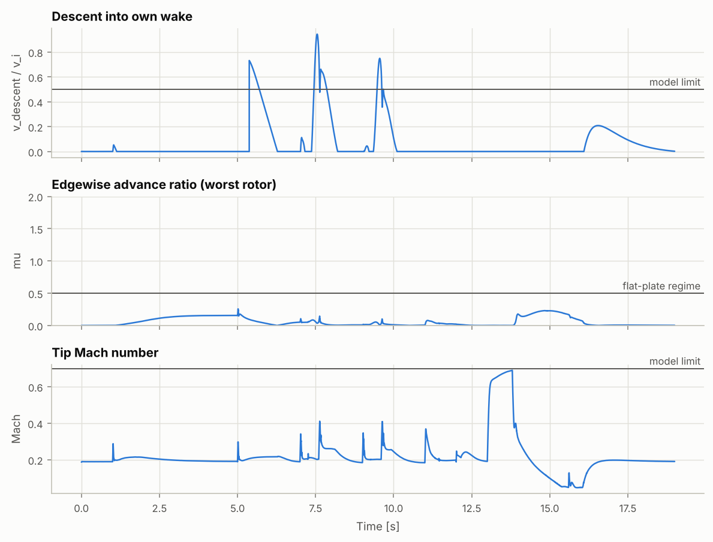

# 飛行測試報告：綜合飛行：10 m/s 前飛、滾轉翻、後空翻、原地自轉、衝刺、收油下墜（`freestyle`）

> 由 `fpvsim fly` 自動產生。原始 log 在 `flight_log.csv`（欄位格式見 docs/flight-sim.md）。

| 項目 | 內容 |
|---|---|
| 機體 | 參考機：5 吋 6S freestyle（通用零件）（`data/builds/ref-5in-6s-freestyle.toml`） |
| 飛控設定 | 5 吋 Acro 基準設定（`acro-5in-baseline`，設定雜湊 `b021b7873281ce99`） |
| 輸入 | `freestyle` |
| 程式版本 | fpvsim 0.1.0，git `f6b199d053aa`；Python 3.13.16、numpy 2.5.3、scipy 1.18.1、matplotlib 3.11.2 |
| 輸入檔雜湊 | `840c2bd32520d2ec` |
| 隨機種子 | 1 |
| 風 | 無風 |
| 地面效應 | 計入（Cheeseman–Bennett） |
| 槳的斜向氣流係數表 | `716995a56ba1313a213d`（rotor_ff.py，輸入與求解器的雜湊） |
| 更新率 | 物理 8000 Hz，陀螺儀 8000 Hz，PID 4000 Hz，記錄 1000 Hz |
| 產生時間 (UTC) | 2026-10-15 12:43 |

## 摘要

| 項目 | 數值 |
|---|---|
| 飛行時間 | 19.0 s |
| 最大速度（三維 / 水平） | 44.7 / 10.1 m/s（161 / 36 km/h） |
| 最大爬升 / 下降速度 | 44.7 / 4.9 m/s |
| 高度範圍（起始 20 m） | 16.1 – 75.0 m |
| 最大傾角 | 179° |
| 最大角速度（滾轉 / 俯仰 / 偏航） | 788 / 806 / 638 deg/s |
| 最低單芯電壓（ESC 端） | 3.27 V |
| 最大 / 最小電流 | 203 / -77 A（負值為煞車回充） |
| 用電量 | 51 mAh，1.16 Wh |
| 剩餘電量 | 96% |
| 電池溫度（起飛 → 最高） | 25.0 → 26.3 °C |

- 觸地最大速度 0.00 m/s，未墜機（門檻 3 m/s）。

## 1. 姿態控制

| 軸 | 追蹤誤差 (RMS) | 延遲（互相關） | 最大命令角速度 |
|---|---|---|---|
| 滾轉 | 34.8 deg/s | 23 ms | 670 deg/s |
| 俯仰 | 37.4 deg/s | 22 ms | 670 deg/s |
| 偏航 | 10.8 deg/s | 9 ms | 600 deg/s |

## 2. 馬達與動力

## 3. 模型適用範圍監測

模擬器會記錄飛行是否離開物理模型的適用範圍。超出範圍的片段，數值只能當作定性參考。

| 狀況 | 時間占比 | 首次發生 | 影響 |
|---|---|---|---|
| 渦環狀態區（軸向下降 > 0.5 倍懸停誘導速度，且水平速度低於懸停誘導速度） | 4.7% | 5.38 s | 平均誘導速度用經驗曲線（Leishman），平均推力的不確定度較大；推力脈動（propwash）未建模 |
| 槳在低轉速高速狀態（前進比 μ 或入流比 \|λ\| > 0.5，以槳尖速度計） | 7.2% | 13.90 s | 葉片大部分失速或逆流，槳力來自平板失速模型，只能定性參考；常見於收油後的高速俯衝或爬升滑行 |
| 軸向前進比超出槳係數數據（J ≥ 0.85），但未到低轉速高速狀態 | 2.1% | 13.83 s | 推力接近零或為負（風車狀態），沒有軸向數據，沿用斜向氣流表格的趨勢（入流平移與倍數保持在數據端點） |
| 槳尖馬赫數 > 0.7 | 0.0% | — | 未計入壓縮性，推力與扭矩偏樂觀 |
| 混控飽和 | 0.6% | 1.00 s | 馬達已到 0% 或 100%，姿態控制能力受限；不是模型問題，是飛行限制 |
| 接觸地面 | 0.0% | — | 接地模型為簡化的彈簧阻尼與庫侖摩擦 |
| 地面效應區（推力增加 > 2%） | 0.0% | — | Cheeseman–Bennett 單槳模型；多旋翼槳與槳之間的干擾未建模 |

## 4. 這次模擬沒有包含的東西

- 渦環狀態只模擬平均誘導速度（經驗曲線）；推力脈動與 propwash 抖動不模擬
- 機架彈性與共振；振動只進入陀螺儀量測，不影響剛體運動
- 紊流的空間變化（各顆槳感受到的陣風相同，沒有旋轉紊流分量）；懸停時凍結紊流假設不成立
- 槳的斜向氣流係數以剛性與自由揮舞兩個極限混合（`prop.flap_fraction`），尚未用風洞數據確認
- 自動測試飛手只是測試工具，不代表人類飛手的反應與習慣
