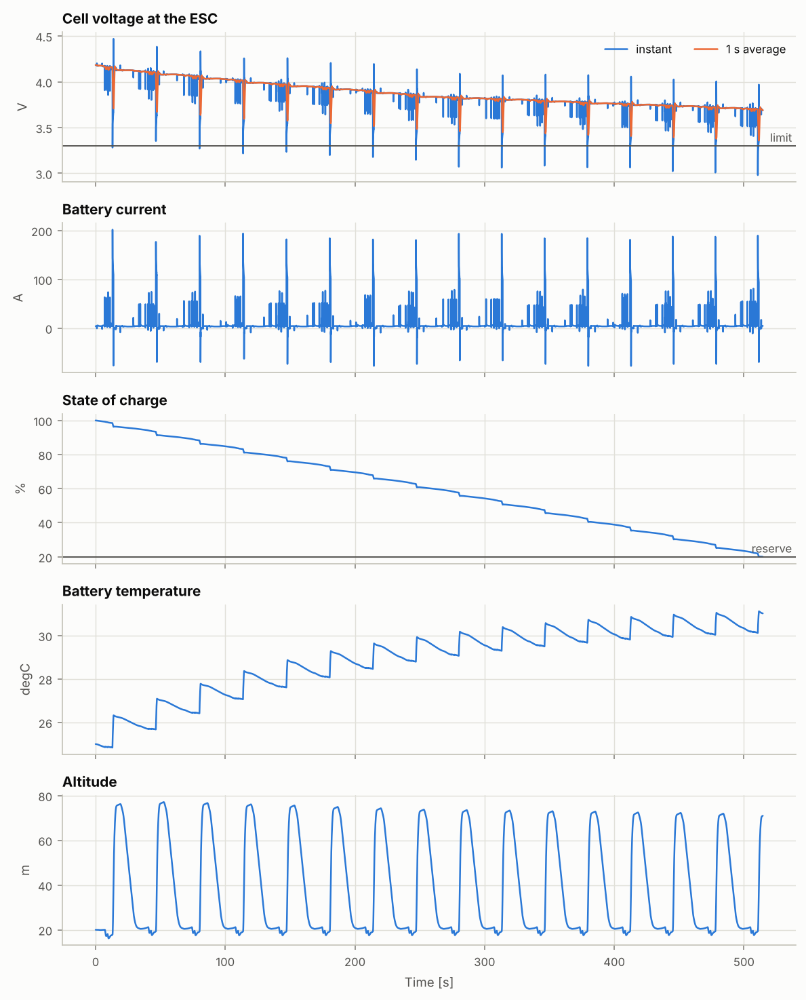

# 任務續航報告：參考機：5 吋 6S freestyle（通用零件）

> 由 `fpvsim mission` 自動產生。6DOF 模擬重複飛同一段飛行腳本，從滿電飛到電池用盡；方法見 docs/battery.md。`mission_log.csv` 是 10 Hz 的精簡 log（電池、油門、轉速與飛行路徑）。

| 項目 | 內容 |
|---|---|
| 機體 | 參考機：5 吋 6S freestyle（通用零件）（`data/builds/ref-5in-6s-freestyle.toml`） |
| 飛控設定 | 5 吋 Acro 基準設定（`acro-5in-baseline`）；陀螺儀與 PID 迴圈 4000 Hz；實際飛的設定雜湊 `163e9f2525d1c838` |
| 每圈 | `freestyle` 腳本 19 s，之後前飛下降回到起始高度再開始下一圈 |
| 風 | 無風 |
| 槳的斜向氣流係數表 | `716995a56ba1313a213d`（rotor_ff.py，輸入與求解器的雜湊） |
| 物理更新率 | 4000 Hz（RK4），記錄 50 Hz |
| 程式版本 | fpvsim 0.1.0，git `f6b199d053aa`；Python 3.13.16、numpy 2.5.3、scipy 1.18.1、matplotlib 3.11.2 |
| 輸入檔雜湊 | `840c2bd32520d2ec` |
| 參數覆寫 | 無 |
| 產生時間 (UTC) | 2026-10-15 13:05 |

## 摘要

| 項目 | 數值 |
|---|---|
| 任務時間 | 515 s（8.6 min），15 圈完成，加第 16 圈約 51%（以平均圈長計） |
| 結束原因 | 達到保留電量 |
| 懸停續航（設計報告） | 865 s；任務時間為其 59% |
| 用電量 | 1040 mAh（剩餘 20%），22.9 Wh |
| 平均功率 / 平均電流 | 160 W / 7.3 A |
| 最大電流 | 202 A |
| 最低單芯電壓（瞬間 / 1 秒平均） | 2.98 / 3.36 V（下限 3.30 V） |
| 電池溫度（起飛 → 最高） | 25.0 → 31.1 °C |

## 1. 各圈

| 圈 | 開始 s | 長度 s | 開始高度 m | 最高高度 m | 用電 mAh | 平均功率 W | 最低單芯電壓（1 秒平均） | 最高電池溫度 |
|---|---|---|---|---|---|---|---|---|
| 1 | 0 | 33 | 20.0 | 76 | 65 | 164 | 3.71 V | 26.3 °C |
| 2 | 33 | 34 | 20.7 | 77 | 66 | 164 | 3.67 V | 27.1 °C |
| 3 | 67 | 34 | 20.7 | 77 | 66 | 162 | 3.64 V | 27.8 °C |
| 4 | 101 | 33 | 20.7 | 76 | 66 | 160 | 3.59 V | 28.4 °C |
| 5 | 134 | 33 | 20.7 | 76 | 66 | 161 | 3.57 V | 28.9 °C |
| 6 | 168 | 33 | 20.7 | 75 | 66 | 160 | 3.55 V | 29.3 °C |
| 7 | 201 | 33 | 20.7 | 74 | 66 | 155 | 3.52 V | 29.6 °C |
| 8 | 234 | 33 | 20.7 | 74 | 66 | 158 | 3.48 V | 29.9 °C |
| 9 | 267 | 33 | 20.7 | 74 | 66 | 157 | 3.46 V | 30.2 °C |
| 10 | 300 | 33 | 20.7 | 73 | 66 | 156 | 3.45 V | 30.4 °C |
| 11 | 333 | 33 | 20.7 | 73 | 66 | 157 | 3.44 V | 30.6 °C |
| 12 | 366 | 33 | 20.7 | 73 | 66 | 156 | 3.42 V | 30.7 °C |
| 13 | 399 | 33 | 20.7 | 72 | 66 | 152 | 3.41 V | 30.9 °C |
| 14 | 432 | 33 | 20.7 | 72 | 66 | 156 | 3.39 V | 31.0 °C |
| 15 | 465 | 33 | 20.7 | 72 | 66 | 156 | 3.38 V | 31.0 °C |
| 16（未完成） | 498 | 17 | 20.7 | 71 | 48 | 213 | 3.36 V | 31.1 °C |

## 2. 模型適用範圍

整段任務超出模型適用範圍的時間比例（與飛行測試報告相同的監測）：

| 狀態 | 時間比例 | 第一次出現 | 影響 |
|---|---|---|---|
| 渦環狀態區（軸向下降 > 0.5 倍懸停誘導速度，且水平速度低於懸停誘導速度） | 2.6% | 5.4 s | 平均誘導速度用經驗曲線（Leishman），平均推力的不確定度較大；推力脈動（propwash）未建模 |
| 槳在低轉速高速狀態（前進比 μ 或入流比 \|λ\| > 0.5，以槳尖速度計） | 4.3% | 13.9 s | 葉片大部分失速或逆流，槳力來自平板失速模型，只能定性參考；常見於收油後的高速俯衝或爬升滑行 |
| 軸向前進比超出槳係數數據（J ≥ 0.85），但未到低轉速高速狀態 | 1.2% | 13.8 s | 推力接近零或為負（風車狀態），沒有軸向數據，沿用斜向氣流表格的趨勢（入流平移與倍數保持在數據端點） |
| 槳尖馬赫數 > 0.7 | 0.0% | — | 未計入壓縮性，推力與扭矩偏樂觀 |
| 混控飽和 | 0.4% | 7.6 s | 馬達已到 0% 或 100%，姿態控制能力受限；不是模型問題，是飛行限制 |
| 接觸地面 | 0.0% | — | 接地模型為簡化的彈簧阻尼與庫侖摩擦 |
| 地面效應區（推力增加 > 2%） | 0.0% | — | Cheeseman–Bennett 單槳模型；多旋翼槳與槳之間的干擾未建模 |

渦環狀態區的時間（共 13.1 s）依飛行階段分配（每個腳本動作從它開始到下一個動作開始，含改出）：

| 飛行階段 | 時間 | 佔這段時間 |
|---|---|---|
| 滾轉翻 | 6.08 s | 46% |
| 前飛與煞停 | 4.42 s | 34% |
| 後空翻 | 2.64 s | 20% |

## 3. 驗證

- 電荷一致性：記錄的用電量（模擬迴圈每個物理步長以前向歐拉累加電流）1039.8 mAh，電池模型以 RK4 積分的電量變化 1040.0 mAh，相差 -0.02%。兩者都在物理步長上積分同一個模擬電流，所以這只檢查積分方法的一致性，不能檢查物理模型本身。

## 4. 方法與限制

- 結束條件：保留電量、單芯電壓的 1 秒平均值達到下限（相當於 OSD 低電壓警告；衝刺時的瞬間壓降不算）、電池溫度上限、墜機。
- 測試飛手每圈開始時依電池目前的狀態重新估計懸停油門，就像真人飛手會隨電壓下降加油門；它不代表真人的飛行風格。
- 每圈最高比開始高約 53 m；腳本結束後測試飛手轉向起點的方向（以轉彎代替急煞，側向加速度 0.4 g），空速以 0.5 g 增加到 2 倍懸停誘導速度（由平均風算出），下降率最多 1 倍懸停誘導速度（空速低於懸停誘導速度時為 0.4 倍）；離起始高度 20 m 還有 8 m 時開始以 0.25 g 減速，下降率再扣掉減速時從下方穿過傾斜槳盤的氣流（0.25 倍空速），在起始高度 ±1 m 內、空速降到 0.5 倍懸停誘導速度時開始下一圈（各圈開始高度 20.7–20.7 m）。這次任務的高度範圍 16–77 m。空氣密度固定在規格的高度。
- 物理以 4 kHz 計算（陀螺儀與 PID 迴圈也是 4 kHz），以減少計算時間；調參與飛行測試報告用 8 kHz。
- 沒有馬達溫升（銅損使電阻上升、磁鐵升溫使 Kt 下降），長時間大電流飛行時會讓結果偏樂觀（見 docs/physics-roadmap.md）。
