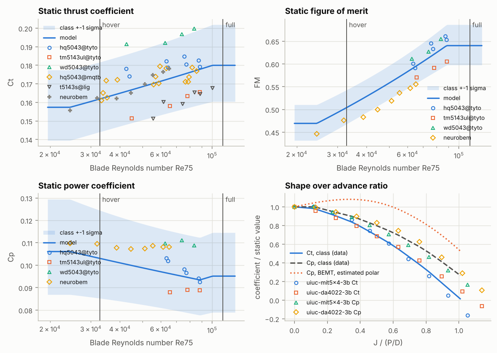

# 槳的校正與驗證報告：5.1×4.3 吋三葉槳（5 吋三葉槳靜態推力台公開數據）

> 由 `fpvsim validate-prop` 自動產生。把通用槳的係數與它所代表的這一類槳的公開推力台數據比較：擬合這一類的平均與分散、檢查零件檔是否與擬合一致，並畫出模型與每一個數據點。方法見 docs/models.md 與 docs/methodology.md §7。

| 項目 | 內容 |
|---|---|
| 驗證數據 | `data/validation/props-5in-tri.toml`（props-5in-tri，擷取日期 2026-10-14）：12 組靜態數據、45 點，2 組前進比形狀 |
| 槳零件檔 | `data/components/props/generic-5.1x4.3x3.toml` |
| 工作點所用的機體 | 參考機：5 吋 6S freestyle（通用零件）（`data/builds/ref-5in-6s-freestyle.toml`），空氣 1.225 kg/m³、動黏度 14.61 mm²/s |
| 程式版本 | fpvsim 0.1.0，git `f6b199d053aa`；Python 3.13.16、numpy 2.5.3、scipy 1.18.1、matplotlib 3.11.2 |
| 輸入檔雜湊（數據 + 零件檔） | `cf6c357a8f689195` |
| 產生時間 (UTC) | 2026-10-15 12:41 |

## 摘要

- 這一類槳在 Re75 = 60,000：Ct = 0.1714 ± 11.2%、FM = 0.583 ± 6.5%（Cp = 0.0971），1σ，為一款新槳相對於這一類平均的預測不確定度。
- 雷諾數趨勢：Ct ∝ Re^0.095（± 0.048，推力數據 Re75 = 24,420–100,395），FM ∝ Re^0.241（± 0.058，扭矩數據 Re75 = 24,420–88,547）。
- 懸停：9,407 rpm，Re75 = 32,761，Ct = 0.1618，FM = 0.504。
- 滿油門：31,969 rpm，Re75 = 111,335（超出數據範圍的部分保持在邊界值），Ct = 0.1800，FM = 0.640。
- 零件檔與擬合一致（16/16 項在捨入誤差內，見第 2 節）。

## 1. 數據

每一點都個別引用（來源網址與它在原始資料中的位置記在數據檔裡）；品牌與型號只用來標示受測物。係數以各數據自己的空氣密度換算，雷諾數 Re75 = Ω (0.75 R) c75 / ν，c75 = 10 mm 對整類槳相同，所以 Re75 實際上是換算後的轉速。

| 數據 | 受測物 | 推力台 | 點數（推力 / 扭矩） | Re75 | 用於等級 | 出處 |
|---|---|---|---|---|---|---|
| `tyto-wek` | HQ Prop 5043（5×4.3 吋，PC，三葉）；馬達 DYS Samguk Shu 2306 2500KV | RCbenchmark Series 1585 推力台（推力、扭矩、轉速、電壓、電流） | 4 / 3 | 43,959–88,242 | 是 | [來源](https://database.tytorobotics.com/tests/wek/dys-samguk-shu-hq-5043) |
| `tyto-79e` | HQ Prop 5043（同上）；馬達 DYS Samguk Wei 2207 2600KV | RCbenchmark Series 1585（同上） | 4 / 3 | 42,504–87,173 | 是 | [來源](https://database.tytorobotics.com/tests/79e/dys-samguk-wei-hq-5043) |
| `tyto-ne4` | T-Motor 5143 Ultra-Light（5.1×4.3 吋，PC，三葉）；馬達 DYS Samguk Shu 2306 2500KV | RCbenchmark Series 1585（同上） | 4 / 3 | 44,932–88,547 | 是 | [來源](https://database.tytorobotics.com/tests/ne4/dys-samguk-shu-t-motor-5143-ultralight) |
| `tyto-77e` | Gemfan 5043 WinDancer（5×4.3 吋，PC，三葉）；馬達 DYS Samguk Shu 2306 2500KV | RCbenchmark Series 1585（同上） | 4 / 3 | 42,743–83,547 | 是 | [來源](https://database.tytorobotics.com/tests/77e/dys-samguk-shu-gemfan-5043-windancer) |
| `mqtb-282` | HQ v1s 5x4.3x3PC；馬達 Hypetrain Cricket 2306.6 2550KV | MiniQuadTestBench 自製推力台（HX711 荷重元、EagleTree eRPM 感測器），XRotor 40A ESC，4S | 3 / 0 | 35,283–78,838 | 是 | [來源](https://www.miniquadtestbench.com/assets/components/motordata/motorinfo.php?uid=282) |
| `mqtb-256` | HQ v1s 5x4.3x3PC；馬達 T-Motor F60 Pro II 2500KV | MiniQuadTestBench（同上） | 3 / 0 | 34,937–82,090 | 是 | [來源](https://www.miniquadtestbench.com/assets/components/motordata/motorinfo.php?uid=256) |
| `mqtb-214` | HQ v1s 5x4.3x3PC；馬達 Emax RSII 2306 2400KV | MiniQuadTestBench（同上） | 3 / 0 | 33,289–76,789 | 是 | [來源](https://www.miniquadtestbench.com/assets/components/motordata/motorinfo.php?uid=214) |
| `mqtb-250` | HQ v1s 5x4.3x3PC；馬達 iFlight Xing 2306 2450KV | MiniQuadTestBench（同上） | 3 / 0 | 33,853–79,425 | 是 | [來源](https://www.miniquadtestbench.com/assets/components/motordata/motorinfo.php?uid=250) |
| `mqtb-208` | HQ v1s 5x4.3x3PC；馬達 DYS Samguk Shu 2306 2800KV | MiniQuadTestBench（同上） | 3 / 0 | 39,012–85,475 | 是 | [來源](https://www.miniquadtestbench.com/assets/components/motordata/motorinfo.php?uid=208) |
| `lig-v2306v2-2400` | T-Motor T5143S（5.1×4.3 吋，三葉）；馬達 T-Motor V2306 V2 2400KV，4S | 馬達廠商推力台（型式未公布） | 3 / 0 | 55,596–88,829 | 是 | [來源](https://www.ligpower.com/product/v2306-v2-fpv-motor.html) |
| `lig-v2306v2-1950` | T-Motor T5143S（同上）；馬達 T-Motor V2306 V2 1950KV，6S | 馬達廠商推力台（同上） | 3 / 0 | 61,603–100,395 | 是 | [來源](https://www.ligpower.com/product/v2306-v2-fpv-motor.html) |
| `neurobem-stand` | 5.1 吋三葉槳（NeuroBEM 程式的 BEM 參數：半徑 64.77 mm、3 葉；同一研究的飛行器用 5.1×4.8 吋槳，未說明推力台用的是否同一款） | 單槳六軸力與力矩推力台，階梯油門（每階至少 2 秒） | 8 / 8 | 24,420–65,185 | 否（只用於趨勢） | [來源](https://download.ifi.uzh.ch/rpg/NeuroBEM/code.tar.xz) |

- `tyto-wek`：降序掃描的後段（低轉速）由扭矩換算的馬達加 ESC 效率持續上升，最後一階超過 100%（6583 rpm：111%），顯示扭矩讀數有隨時間累積的漂移；只用前段的扭矩。推力沒有這個現象（低轉速的 Ct 與趨勢一致）
- `neurobem-stand`：檔中各階平均值在零點修正之前計算（SegmentMeasurement.m 先求平均再修正原始數據），原始記錄開頭停轉時 fz = −0.012 N、mz = +0.0001 N m，結尾冷卻段 fz = −0.20 N，所以推力可能偏低幾個百分比；這是不用於等級的另一個原因。最低兩階（< 5000 rpm）推力不到 0.31 N，不收錄
- 推力台之間的系統誤差取 5%：同一款槳在兩台獨立推力台上：HQ 5x4.3x3 的 Ct 在 Tyto（Rob Hessler）比 MiniQuadTestBench 高約 3.5%；唯一的學術扭矩數據（NeuroBEM）的 FM 比資料庫的平均低約 6%（槳不同）。Tyto 資料庫另有一台（Julien Lariviere-Chartier）量同一款 5.1×5 槳，Ct 低 28%、FM 低 30%，與另外兩個來源都不符，判定為該台異常（不屬本類，未收錄）。據此取 5%。

看過但沒有收錄的數據：

| 數據 | 原因 |
|---|---|
| Tyto 資料庫，上傳者 Sean Kovacs（2022，RCbenchmark Series 1520）：Gemfan W 5043x3 與 T5143x3 搭配多顆馬達 | Ct 0.084–0.087，約為其他所有來源的一半（同一款槳在 Tyto 另一台推力台為 0.19–0.20），很可能是轉速設定錯誤 |
| Tyto 資料庫，T-Motor LF40 2305 搭配 T-5143（測試 mny）與 LF40 搭配 T5143（測試 zny） | mny 的 Ct 約 0.10、zny 約 0.98，與其他來源（0.15–0.17）不符，應是轉速的極對數設定錯誤 |
| Tyto 資料庫，Gemfan Hurricane 51499 的兩組上傳（Rob Hessler 與 Julien Lariviere-Chartier） | 5.1×5 吋（P/D 0.98），不屬本類；兩台推力台的差異（Ct 28%、FM 30%）列入推力台系統誤差的說明 |
| UIUC Propeller Data Site 第 2 冊的 5 吋三葉槳（DA4022、DA4052、NR640、5x4 碳纖槳） | 靜態數據不用於等級與趨勢：轉速只到 6,000–10,000 rpm（Re75 約 2–3.5 萬），低於本類的懸停到滿油門範圍，槳型（3D 列印寬弦長、碳纖薄葉）也不同。定性上一致：FM 隨轉速上升。其中兩款的風洞數據用於前進比的形狀（[[shape]]） |

## 2. 擬合

每組數據各自以最小平方法擬合 log y = log y_ref + n log(Re/Re_ref)（y = Ct 或 FM，Re_ref = 60,000）；同一款槳在同一台推力台上的數據（例如同一頁上的不同馬達）先平均成一組。這一類的等級是用於等級的各組在 Re_ref 的幾何平均，指數是所有組的平均。不確定度是一款新槳的預測標準差 s √(1 + 1/n)（n 組、樣本標準差 s），等級另外加上推力台之間的系統誤差。

| 組 | 用於等級 | Ct(Re_ref) | Ct 指數 | FM(Re_ref) | FM 指數 | 組內數據數 |
|---|---|---|---|---|---|---|
| `hq5043@tyto` | 是 | 0.1793 | 0.045 | 0.586 | 0.315 | 2 |
| `tm5143ul@tyto` | 是 | 0.1571 | 0.133 | 0.561 | 0.196 | 1 |
| `wd5043@tyto` | 是 | 0.1943 | 0.061 | 0.603 | 0.233 | 1 |
| `hq5043@mqtb` | 是 | 0.1726 | 0.059 | — | — | 5 |
| `t5143s@lig` | 是 | 0.1565 | 0.138 | — | — | 2 |
| `neurobem` | 否 | 0.1749 | 0.137 | 0.541 | 0.220 | 1 |
| **這一類** |  | **0.1714** ± 11.2% | **0.095** ± 0.048 | **0.583** ± 6.5% | **0.241** ± 0.058 |  |

等級的數據來源：Ct 來自 5 組、3 種推力台；FM（因而 Cp）來自 3 組有扭矩的數據、1 種推力台，推力台之間的差異只由系統誤差項代表。

零件檔與擬合的比較（零件檔的數值是擬合結果捨入後的值）：

| 項目 | 擬合 | 零件檔 | 容許差 | 一致 |
|---|---|---|---|---|
| Ct(J = 0) | 0.17137 | 0.1714 | 0.2% | 是 |
| FM(J = 0) | 0.58314 | 0.58309 | 0.2% | 是 |
| max \|ΔCt(J)\| | 0 | 4.7706e-05 | 0.0001 | 是 |
| max \|ΔCp(J)\| | 0 | 4.9477e-05 | 0.0001 | 是 |
| Ct 不確定度 | 0.11229 | 0.112 | 0.001 | 是 |
| FM 不確定度 | 0.06539 | 0.065 | 0.001 | 是 |
| Re 的弦長 c75 | 0.01 | 0.01 | 1e-09 | 是 |
| Re_ref | 60000 | 60000 | 0.0% | 是 |
| Ct 的 Re 下限 | 24420 | 24400 | 0.5% | 是 |
| Ct 的 Re 上限 | 1.004e+05 | 1.004e+05 | 0.5% | 是 |
| FM 的 Re 下限 | 24420 | 24400 | 0.5% | 是 |
| FM 的 Re 上限 | 88547 | 88500 | 0.5% | 是 |
| Ct 指數 | 0.095245 | 0.095 | 0.001 | 是 |
| Ct 指數不確定度 | 0.048398 | 0.048 | 0.001 | 是 |
| FM 指數 | 0.24119 | 0.241 | 0.001 | 是 |
| FM 指數不確定度 | 0.057776 | 0.058 | 0.001 | 是 |

## 3. 前進比的形狀

上面的數據都是靜態（J = 0）。Ct、Cp 隨前進比的變化取自 UIUC 兩款 5 吋三葉槳的風洞數據，各以同轉速的靜態值正規化，橫軸用 x = J / (P/D) 對齊不同螺距的槳；零件檔的 Ct(J)、Cp(J) 為靜態等級乘上兩款的平均形狀。

| 槳 | P/D | 轉速 | 出處 |
|---|---|---|---|
| UIUC 第 2 冊的 5×4 三葉碳纖薄翼槳（實測直徑 4.9 吋） | 0.816 | 6,057 rpm | [J>0](https://m-selig.ae.illinois.edu/props/volume-2/data/mit_5x4_0366rd_6057.txt)、[靜態](https://m-selig.ae.illinois.edu/props/volume-2/data/mit_5x4_static_0362rd.txt) |
| UIUC 第 2 冊的 DA4022 三葉槳（3D 列印，矩形葉片 c/R 0.23，SDA1075 翼型，直徑 5 吋） | 0.750 | 6,034 rpm | [J>0](https://m-selig.ae.illinois.edu/props/volume-2/data/da4022_5x3.75_3b_0694md_6034.txt)、[靜態](https://m-selig.ae.illinois.edu/props/volume-2/data/da4022_5x3.75_3b_static_0690md.txt) |

| x = J/(P/D) | Ct/Ct₀（數據，平均 ± 半差） | Cp/Cp₀（數據） | Ct/Ct₀（BEMT，估計翼型） | Cp/Cp₀（BEMT，估計翼型） | Ct/Ct₀（BEMT，翼型校正到靜態值） | Cp/Cp₀（BEMT，翼型校正到靜態值） |
|---|---|---|---|---|---|---|
| 0.21 | 0.932 ± 0.023 | 0.962 ± 0.003 | 0.965 | 1.065 | 0.905 | 1.039 |
| 0.39 | 0.797 ± 0.016 | 0.871 ± 0.017 | 0.876 | 1.077 | 0.781 | 1.048 |
| 0.50 | 0.695 ± 0.004 | 0.801 ± 0.030 | 0.801 | 1.051 | 0.697 | 1.031 |
| 0.60 | 0.586 ± 0.013 | 0.724 ± 0.042 | 0.709 | 0.998 | 0.605 | 0.995 |
| 0.80 | 0.323 ± 0.046 | 0.525 ± 0.046 | 0.488 | 0.809 | 0.405 | 0.868 |

為什麼不直接校正 BEMT：把升力斜率與最小阻力調到重現靜態 Ct 與 FM（升力斜率 3.72 /rad、最小阻力 0.0686），BEMT 的 Cp 在 x = 0.5 仍比數據高約 29%：單一翼型極曲線的 BEMT 無法同時符合靜態效率與前進時的效率（真實的小槳在靜態時有 BEMT 沒有的損失）。所以軸向係數用數據；BEMT 只提供斜向氣流相對於軸向的變化（rotor_ff.py，錨定在這些曲線上）。

## 4. 模型與數據

模型（零件檔的係數加上雷諾數修正）在各數據點的 Re75 的值，與數據的平均對數差；z = 差 / 這一類的等級不確定度（|z| < 2 表示這組數據在一款新槳的 95% 預測範圍內）。

| 組 | Ct 點數 | Ct 數據 / 模型 − 1 | z | FM 點數 | FM 數據 / 模型 − 1 | z |
|---|---|---|---|---|---|---|
| `hq5043@tyto` | 8 | +4.1% | +0.36 | 6 | +2.3% | +0.35 |
| `tm5143ul@tyto` | 4 | -7.9% | -0.74 | 3 | -4.9% | -0.77 |
| `wd5043@tyto` | 4 | +13.1% | +1.10 | 3 | +3.3% | +0.49 |
| `hq5043@mqtb` | 15 | +1.0% | +0.09 | — | — | — |
| `t5143s@lig` | 6 | -8.0% | -0.74 | — | — | — |
| `neurobem` | 8 | +0.8% | +0.07 | 8 | -6.6% | -1.05 |

## 5. 方法與限制

- 通用槳代表的是「這一類槳」，不是某一款產品：等級的不確定度包含不同產品與不同推力台的差異。買到的槳實測一次（`fpvsim fit-prop`）就能把這些換成那一款槳自己的數值。
- 雷諾數修正對所有前進比使用同一個倍數；前進比的形狀數據在 Re75 約 2 萬，比這一類的工作範圍低。沒有 5 吋三葉槳在 Re75 = 3×10⁴–10⁵ 有風速的公開數據。
- 數據範圍外（Re75 < 下限或 > 上限）係數保持在邊界值，不外插。
- 推力台的空氣密度多半沒有公布，依各數據檔記載的假設換算（誤差約 ±3%，已涵蓋在推力台系統誤差內）。
- 斜向氣流（前飛、側風）的變化來自 BEMT 與估計的槳葉幾何，只錨定在這些軸向曲線上，沒有斜向氣流的數據驗證。
