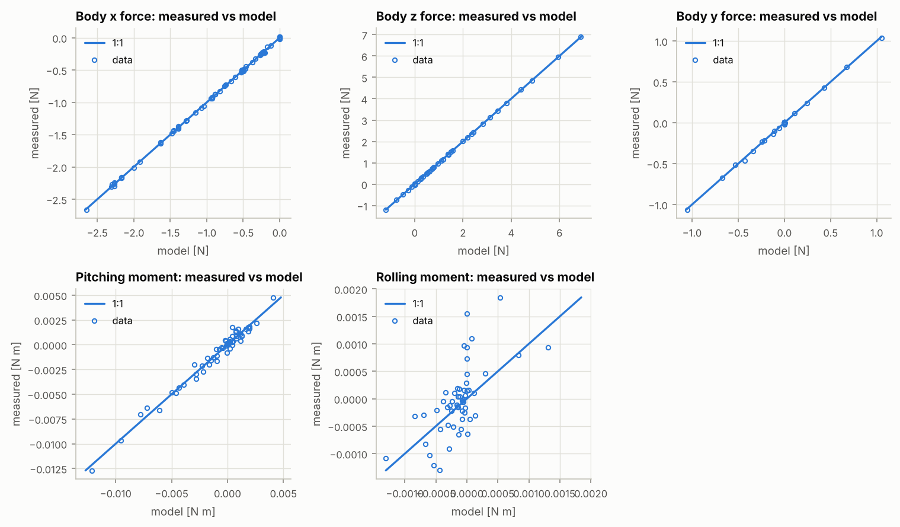

# 風洞數據辨識報告：參考機：5 吋 6S freestyle（通用零件）

> 由 `fpvsim fit-tunnel` 自動產生。模型與方法見 docs/tunnel.md。

| 項目 | 內容 |
|---|---|
| 數據 | `reports/tunnel-fit/balance.csv`（拆槳 55 筆、轉動 10 筆） |
| 機體 | 參考機：5 吋 6S freestyle（通用零件）（`data/builds/ref-5in-6s-freestyle.toml`） |
| 程式版本 | fpvsim 0.1.0，git `f6b199d053aa`；Python 3.13.16、numpy 2.5.3、scipy 1.18.1、matplotlib 3.11.2 |
| 產生時間 (UTC) | 2026-10-15 12:42 |

## 1. 辨識結果

最小平方法，HC3 穩健標準誤差。阻力面積為整機總和（機架加上有自己阻力的零件），阻力中心為相對重心的位置。「模型目前值」是設計檔的標稱值，差距以辨識的標準不確定度為單位。

| 參數 | 辨識值 | 模型目前值 | 差距 |
|---|---|---|---|
| 阻力面積 S_x | 60.19 ± 0.11 cm² | 60.00 cm² | +1.8σ |
| 阻力面積 S_z | 179.51 ± 0.31 cm² | 180.00 cm² | -1.6σ |
| 阻力面積 S_y | 80.42 ± 0.69 cm² | 80.00 cm² | +0.6σ |
| 阻力中心 高度（由 x 向阻力的俯仰力矩，下為正） | -0.86 ± 0.06 mm | — | — |
| 阻力中心 x 位置（由 z 向阻力的俯仰力矩） | +1.77 ± 0.05 mm | — | — |
| 阻力中心 y 位置（由 z 向阻力的滾轉力矩） | -0.10 ± 0.03 mm | — | — |
| 槳的揮舞比例 `flap_fraction` | 0.504 ± 0.007 | 0.500 | +0.6σ |

- `fx`：65 筆，殘差 RMS 0.0123，R² 0.9997
- `fz`：55 筆，殘差 RMS 0.0136，R² 0.9999
- `fy`：55 筆，殘差 RMS 0.00882，R² 0.9990
- `my`：55 筆，殘差 RMS 0.000469，R² 0.9769
- `mx`：55 筆，殘差 RMS 0.000484，R² 0.3939



## 2. 寫回零件檔

機架的阻力面積 = 辨識的總和 − 各零件自己的阻力面積（取標稱值）；阻力中心換算成機架檔的座標（安裝原點）。不確定度取辨識的標準誤差，分布為常態；`source = "synthetic"`。u 只含擬合的統計不確定度（A 類）；實測時還要依儀器規格加上 B 類不確定度（GUM），例如荷重元、電流計與溫度計的校正誤差。

**這些數據是模型產生的合成數據**（檔案第一行標記），所以來源標為 `synthetic`：它們只能驗證辨識流程能否找回已知值，不能當作實測值寫回零件檔。

```toml
# frame component file (data/components/frames/generic-5in-freestyle-225.toml), [params]
cda_x = { value = 60.19, unit = "cm^2", source = "synthetic", u = 0.11, ref = "balance.csv", note = "fpvsim fit-tunnel" }
cda_y = { value = 80.42, unit = "cm^2", source = "synthetic", u = 0.69, ref = "balance.csv", note = "fpvsim fit-tunnel" }
cda_z = { value = 179.51, unit = "cm^2", source = "synthetic", u = 0.31, ref = "balance.csv", note = "fpvsim fit-tunnel" }
# top level of the frame file (before the first table)
drag_center = { value = [0.0, 0.0, -24.9], unit = "mm" }
# prop component file (data/components/props/generic-5.1x4.3x3.toml), [params]
flap_fraction = { value = 0.504, unit = "1", source = "synthetic", u = 0.007, ref = "balance.csv", note = "fpvsim fit-tunnel" }
```

## 3. 方法

- 拆槳：各軸 F = −½ρ|v|·v_軸·S_軸，俯仰力矩 M_y = −½ρ|v|u·(S_x z_x) + ½ρ|v|w·(S_z x_z)，滾轉力矩同理；每條式子對未知數是線性的。
- 轉動（固定轉速、水平氣流）：x 向力另外加上各槳的面內力，在斜向氣流模型中對揮舞比例 f 是線性的：H = H_剛性 + f·(H_自由 − H_剛性)。與拆槳的數據一起擬合，共用 S_x。
- 推力、側力與轉動時的力矩不用於辨識，以免推力模型的誤差混入阻力。
- 用 `fpvsim tunnel --synthetic` 產生的數據來自同一個模型，只能驗證辨識流程（能否找回已知值），不能確認模型；確認需要真實風洞數據。
