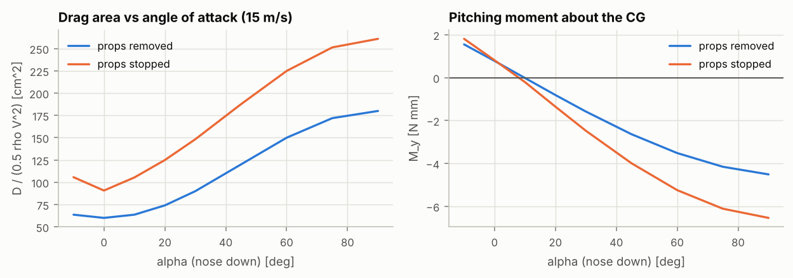
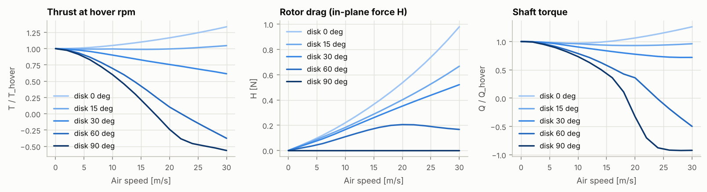
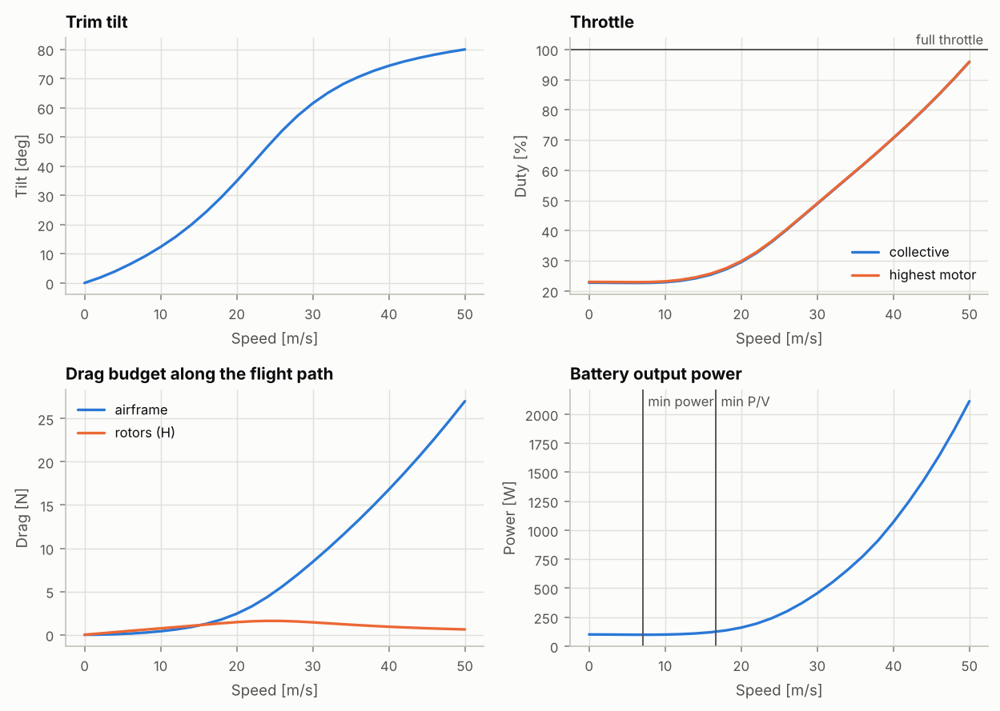
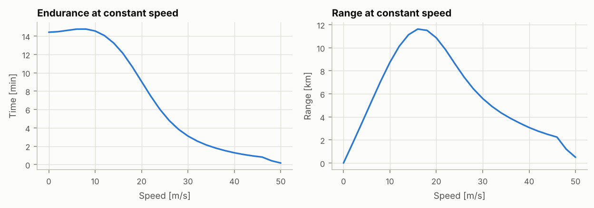

# 虛擬風洞報告：參考機：5 吋 6S freestyle（通用零件）

> 由 `fpvsim tunnel` 自動產生。對象是飛行模擬使用的同一個模型（`dynamics.py`、`rotor_ff.py`），所以這裡的數字就是模擬飛行時的空氣動力。方法見 docs/tunnel.md。

| 項目 | 內容 |
|---|---|
| 機體 | 參考機：5 吋 6S freestyle（通用零件）（`data/builds/ref-5in-6s-freestyle.toml`） |
| 程式版本 | fpvsim 0.1.0，git `f6b199d053aa`；Python 3.13.16、numpy 2.5.3、scipy 1.18.1、matplotlib 3.11.2 |
| 輸入檔雜湊 | `840c2bd32520d2ec` |
| 空氣 | 密度 1.2250 kg/m³（0 m，15.0 °C） |
| 全備重量 | 532 g |
| 電池狀態 | SoC 100%，起始 25 °C |
| 槳的模型 | 斜向氣流葉素模型（rotor_ff.py），係數表 `716995a56ba1313a213d` |
| 蒙地卡羅 | 200 組，種子 1 |
| 產生時間 (UTC) | 2026-10-15 12:42 |

## 摘要

| 項目 | 標稱值 | 90% 區間（蒙地卡羅） |
|---|---|---|
| 續航最久的速度（最低功率） | 7.1 m/s | 5.6 m/s – 9.6 m/s（中位數 7.2 m/s） |
| 航程最遠的速度（最低功率 ÷ 速度） | 16.7 m/s | 14.6 m/s – 21.0 m/s（中位數 16.7 m/s） |
| 最高平飛速度（滿電，全油門） | 51.4 m/s | 43.4 m/s – 60.6 m/s（中位數 50.9 m/s） |
| 10 m/s 配平傾角 | 12.3 ° | 8.8 ° – 15.7 °（中位數 12.2 °） |
| 20 m/s 配平傾角 | 34.9 ° | 24.1 ° – 42.8 °（中位數 34.1 °） |
| 懸停功率 | 101 W | 88 W – 118 W（中位數 102 W） |
| 10 m/s 功率 | 100 W | 86 W – 117 W（中位數 101 W） |
| 20 m/s 功率 | 160 W | 115 W – 223 W（中位數 159 W） |

- 以標稱值計，最省電的速度 7.1 m/s 可飛約 14.8 分鐘；航程最遠的速度 16.7 m/s 約 11.6 km（定速平飛，從滿電飛到 20% 保留電量或電壓下限，見第 5 節）。
- 最高平飛速度 51.4 m/s（185 km/h）時傾角 81°、電池輸出 2297 W（102 A）；這是滿電、靜止空氣中的值，電壓下降後會降低。

## 1. 試驗設定

- 天平量測點在重心，力為機體軸（前、右、下），力矩為對重心的機體軸力矩；升力、阻力、側力是同一個力在風軸的分量。
- 攻角 α 以機頭向下為正（前飛時的前傾），側滑角 β 以風從右方來為正。自由流均勻；真實風洞的洞壁、阻塞與支架修正屬於量測端，不在模型內。
- 槳的狀態：拆槳（只量機身與零件）、停轉（槳固定不轉）、固定轉速（馬達維持該轉速所需的油門）、配平（第 4 節）。
- 停轉的槳由斜向氣流模型計算（失速後的平板模型）。

## 2. 機身阻力極曲線

阻力面積 D/(½ρV²)，攻角 0° 時各風速：

| 風速 m/s | 5 | 10 | 15 | 20 | 30 |
|---|---|---|---|---|---|
| 拆槳 cm² | 60.0 | 60.0 | 60.0 | 60.0 | 60.0 |
| 停轉 cm² | 90.7 | 90.7 | 90.7 | 90.7 | 90.7 |

拆槳時阻力與速度平方成正比，阻力面積不隨風速變化；停轉的槳在這些風速之間差 0.0%。以下攻角掃描取 15 m/s。

| 攻角 | 拆槳 cm² | 停轉 cm² | 拆槳升力 N | 拆槳俯仰力矩 N·mm | 停轉俯仰力矩 N·mm |
|---|---|---|---|---|---|
| -10° | 63.6 | 105.7 | +0.28 | +1.6 | +1.8 |
| 0° | 60.0 | 90.7 | -0.00 | +0.8 | +0.8 |
| 10° | 63.6 | 105.4 | -0.28 | -0.0 | -0.2 |
| 20° | 74.0 | 124.9 | -0.53 | -0.8 | -1.4 |
| 30° | 90.0 | 148.3 | -0.72 | -1.6 | -2.5 |
| 45° | 120.0 | 187.6 | -0.83 | -2.6 | -4.0 |
| 60° | 150.0 | 224.9 | -0.72 | -3.5 | -5.2 |
| 75° | 172.0 | 251.3 | -0.41 | -4.2 | -6.1 |
| 90° | 180.0 | 260.9 | -0.00 | -4.5 | -6.5 |

驗證：α = 0° 拆槳時等於機體 x 向阻力面積總和 60.0 cm²，α = 90° 時等於 z 向 180.0 cm²。攻角 0° 到 90° 之間依模型為兩者以 cos²α、sin²α 加權（各軸獨立的阻力面積）；真實機身的極曲線未必如此，這正是風洞要確認的。

## 3. 動力組在斜向氣流中（單顆槳）

固定在懸停轉速 9407 rpm。槳盤攻角以前傾為正：前飛時氣流從推力側穿過槳盤（類似爬升）；0° 為純水平氣流，90° 為軸向爬升。

| 槳盤攻角 | 風速 m/s | μ | λ | 推力 / 懸停 | H 力 N | 扭矩 / 懸停 |
|---|---|---|---|---|---|---|
| 0° | 10 | 0.16 | 0.00 | 1.049 | 0.219 | 0.971 |
| 0° | 20 | 0.31 | 0.00 | 1.166 | 0.535 | 1.063 |
| 15° | 10 | 0.15 | 0.04 | 0.995 | 0.182 | 0.961 |
| 15° | 20 | 0.30 | 0.08 | 0.995 | 0.401 | 0.930 |
| 30° | 10 | 0.14 | 0.08 | 0.901 | 0.165 | 0.904 |
| 30° | 20 | 0.27 | 0.16 | 0.757 | 0.351 | 0.776 |
| 60° | 10 | 0.08 | 0.14 | 0.696 | 0.109 | 0.788 |
| 60° | 20 | 0.16 | 0.27 | 0.104 | 0.205 | 0.359 |
| 90° | 10 | 0.00 | 0.16 | 0.600 | 0.000 | 0.734 |
| 90° | 20 | 0.00 | 0.31 | -0.240 | 0.000 | -0.327 |

## 4. 配平曲線

每個速度求出水平定速飛行的傾角、總油門與前後油門差，使淨力與俯仰力矩為零，馬達在各自的平衡轉速。滾轉與偏航力矩的殘差列在表中（左右旋槳成對抵消後的剩餘）。

| 速度 m/s | 傾角 | 總油門 | 前後油門差 | 平均轉速 rpm | 功率 W | 電流 A | 阻力：機身 / 槳 N | 旋翼前進比 μ | 滾轉 / 偏航殘差 N·mm |
|---|---|---|---|---|---|---|---|---|---|
| 0 | 0.0° | 22.8% | -0.26% | 9406 | 101 | 4.0 | 0.00 / 0.00 | 0.00 | +0.59 / +0.00 |
| 4 | 4.0° | 22.7% | -0.26% | 9388 | 99 | 4.0 | 0.06 / 0.30 | 0.06 | +0.59 / -0.04 |
| 8 | 9.2° | 22.7% | -0.27% | 9397 | 98 | 3.9 | 0.25 / 0.60 | 0.13 | +0.58 / -0.09 |
| 12 | 15.8° | 23.4% | -0.30% | 9674 | 103 | 4.1 | 0.61 / 0.88 | 0.18 | +0.57 / -0.16 |
| 16 | 24.4° | 25.4% | -0.34% | 10510 | 120 | 4.8 | 1.26 / 1.18 | 0.21 | +0.54 / -0.24 |
| 20 | 34.9° | 29.6% | -0.31% | 12204 | 160 | 6.4 | 2.43 / 1.46 | 0.20 | +0.48 / -0.34 |
| 24 | 46.6° | 36.2% | -0.24% | 14886 | 240 | 9.6 | 4.35 / 1.60 | 0.16 | +0.40 / -0.43 |
| 28 | 57.2° | 44.6% | -0.18% | 18152 | 372 | 15.0 | 6.96 / 1.53 | 0.12 | +0.32 / -0.49 |
| 32 | 65.1° | 53.1% | -0.14% | 21377 | 551 | 22.4 | 9.96 / 1.32 | 0.09 | +0.25 / -0.53 |
| 36 | 70.6° | 61.7% | -0.11% | 24440 | 776 | 31.9 | 13.23 / 1.11 | 0.07 | +0.20 / -0.55 |
| 40 | 74.4° | 70.6% | -0.09% | 27401 | 1069 | 44.5 | 16.79 / 0.93 | 0.06 | +0.16 / -0.57 |
| 44 | 77.1° | 80.0% | -0.08% | 30307 | 1432 | 60.7 | 20.64 / 0.78 | 0.05 | +0.13 / -0.57 |
| 48 | 79.2° | 90.3% | -0.08% | 33202 | 1867 | 81.0 | 24.80 / 0.66 | 0.04 | +0.11 / -0.58 |
| 50 | 80.0° | 95.9% | -0.07% | 34635 | 2113 | 92.9 | 27.01 / 0.61 | 0.04 | +0.10 / -0.58 |

前後油門差抵消重心偏移與氣動力矩；負值表示後方馬達較快。

## 5. 功率曲線與最佳巡航速度

定速平飛，從滿電、靜置的電池開始，每 5 秒依電池狀態重新配平，直到保留電量、負載下單芯電壓下限或電池溫度上限；電池散熱依空速計算。速度 0 即懸停：865 s，設計報告的懸停續航（靜態動力系統模型）為 865 s，相差 +0.02%（兩者的時間步長不同，且配平包含前後油門差）。

| 速度 m/s | 續航 min | 航程 km | 結束原因 |
|---|---|---|---|
| 0 | 14.4 | 0.00 | 達到保留電量 |
| 4 | 14.6 | 3.51 | 達到保留電量 |
| 8 | 14.8 | 7.09 | 達到保留電量 |
| 12 | 14.1 | 10.12 | 達到保留電量 |
| 16 | 12.1 | 11.62 | 達到保留電量 |
| 20 | 9.1 | 10.86 | 達到保留電量 |
| 24 | 6.0 | 8.62 | 達到保留電量 |
| 28 | 3.8 | 6.43 | 達到保留電量 |
| 32 | 2.6 | 4.91 | 達到保留電量 |
| 36 | 1.8 | 3.87 | 達到保留電量 |
| 40 | 1.3 | 3.08 | 達到保留電量 |
| 44 | 0.9 | 2.49 | 達到保留電量 |
| 48 | 0.4 | 1.20 | 電壓不足以維持此速度 |

最低功率的速度 7.1 m/s、最低「功率 ÷ 速度」的速度 16.7 m/s 由滿電時的功率曲線求得（拋物線內插）；續航與航程曲線的最大值會因電池放電略有偏移。最高平飛速度在電壓下降後會降低，表中高速點可能因此提早結束（「電壓不足以維持此速度」）。

## 6. 不確定度

200 組蒙地卡羅樣本（與設計報告相同的參數分布），每組重新計算整條配平曲線。摘要的 90% 區間即來自這裡。

單一參數 ±1σ 的影響（其餘取標稱值），各列前五名：

| 結果 | 參數 | −1σ 到 +1σ | 量測方法 |
|---|---|---|---|
| 20 m/s 配平傾角 | `frame.cda_x` | 29.2 ° – 39.8 ° | 風洞或滑行減速測試 |
| 20 m/s 配平傾角 | `prop.flap_fraction` | 32.4 ° – 37.1 ° | 風洞：槳在斜向氣流中的 H 力（`fpvsim fit-tunnel`），或定速平飛的傾角對速度 |
| 20 m/s 配平傾角 | `prop.ct_scale` | 33.6 ° – 36.1 ° | 推力台量測靜態推力，以 `fpvsim fit-prop` 辨識 Ct |
| 20 m/s 配平傾角 | `frame.cda_z` | 33.6 ° – 36.1 ° | 風洞或滑行減速測試 |
| 20 m/s 配平傾角 | `battery.mass` | 34.5 ° – 35.3 ° | 電子秤秤重 |
| 航程最遠的速度（最低功率 ÷ 速度） | `frame.cda_z` | 15.4 m/s – 18.7 m/s | 風洞或滑行減速測試 |
| 航程最遠的速度（最低功率 ÷ 速度） | `frame.cda_x` | 16.1 m/s – 17.5 m/s | 風洞或滑行減速測試 |
| 航程最遠的速度（最低功率 ÷ 速度） | `prop.ct_scale` | 16.4 m/s – 17.0 m/s | 推力台量測靜態推力，以 `fpvsim fit-prop` 辨識 Ct |
| 航程最遠的速度（最低功率 ÷ 速度） | `prop.flap_fraction` | 16.5 m/s – 17.0 m/s | 風洞：槳在斜向氣流中的 H 力（`fpvsim fit-tunnel`），或定速平飛的傾角對速度 |
| 航程最遠的速度（最低功率 ÷ 速度） | `motor.i0_speed_fraction` | 16.5 m/s – 16.8 m/s | 無槳空載測試，至少兩個電壓 |
| 10 m/s 功率 | `prop.fm_scale` | 95 W – 105 W | 推力台量測扭矩（或電流與轉速），以 `fpvsim fit-prop` 辨識 Cp，由 Ct 與 Cp 得到 FM |
| 10 m/s 功率 | `motor.i0_ref` | 95 W – 105 W | 無槳空載測試，至少兩個電壓 |
| 10 m/s 功率 | `motor.i0_speed_fraction` | 97 W – 103 W | 無槳空載測試，至少兩個電壓 |
| 10 m/s 功率 | `frame.thrust_interference` | 97 W – 103 W | 推力台對比：有機臂遮擋與無遮擋 |
| 10 m/s 功率 | `prop.re_fm_exponent` | 97 W – 103 W | 推力台從懸停到滿油門逐階量測推力與扭矩，以 `fpvsim fit-prop --chord75` 擬合雷諾數趨勢 |

## 7. 建議的實測

1. 拆槳的機身：風速 8–25 m/s、攻角 −10° 到 90°、側滑 ±20°，量阻力面積與俯仰、滾轉力矩（辨識 `frame.cda_*` 與 `drag_center`）。
2. 單顆動力組在固定轉速下的水平氣流：量 H 力與推力（辨識 `prop.flap_fraction`），再加槳盤攻角 15°、30° 確認斜向氣流模型。
3. 量測 CSV 的格式與 `fpvsim tunnel --synthetic` 輸出的相同，用 `fpvsim fit-tunnel` 辨識，結果可直接貼回零件檔。

## 8. 模型假設與限制

- 機身阻力為三軸獨立的阻力面積，作用在固定點（機架）與各零件位置；沒有機身升力與側力的交叉項。
- 槳的斜向氣流係數錨定在軸向曲線，揮舞比例 `flap_fraction` 沒有數據（0 到 1 的均勻分布），是傾角與槳盤阻力不確定度的主要來源之一。
- 槳與槳之間、槳與機身之間的干擾只以固定的推力比例表示；高速時機臂與機身對槳盤入流的影響沒有模擬。
- 配平是靜態平衡，不含飛控動態；配平、功率曲線與最高速度以滿電時的電池電壓計算（定速續航除外，它從滿電飛起）。
